# RK 系列 与 NVIDIA Jetson：嵌入式编解码 / 渲染 / DMA / DRM / Sync 全链路详解

> 平台：Rockchip RK3588/RK3566/RK3399（MPP + RGA + VOP2/DRM）与 NVIDIA Jetson Orin/Xavier（NVDEC/NVENC + VIC + CUDA + DRM/NVKMS）。
> 覆盖：硬件解码全流程、编码全流程、DMA-BUF 生命周期、DRM/KMS 渲染、**双缓冲 vs 三缓冲**、跨引擎同步（dma_fence/syncpts）。
> 图均为 Mermaid；API 名称以官方 SDK/MPP/JetPack 实际接口为准，具体引擎数量以各 SoC datasheet 为准。

---

## 目录

- [1. 两平台硬件画像](#profile)
- [2. DMA-BUF 与内存生命周期 ★](#dma)
  - [2.1 通用的"数字货币"：dma-buf fd](#dma-buf)
  - [2.2 各平台的分配器与堆](#dma-alloc)
  - [2.3 CPU 缓存一致性与同步](#dma-cache)
  - [2.4 引擎间 import/export 能力矩阵](#dma-matrix)
- [3. 解码全流程 ★](#decode)
  - [3.1 RK：MPP 解码完整链路](#dec-rk)
  - [3.2 Jetson：NVDEC / Tegra V4L2 链路](#dec-jetson)
- [4. 编码全流程](#encode)
- [5. 渲染：DRM/KMS 深入](#drm)
  - [5.1 KMS 对象模型：CRTC/Plane/Encoder/Connector](#drm-kms)
  - [5.2 GEM / PRIME：缓冲从解码器到屏幕](#drm-prime)
  - [5.3 Atomic API：一次提交换帧](#drm-atomic)
- [6. 双缓冲 vs 三缓冲 ★](#buffering)
- [7. Sync 跨引擎同步机制 ★](#sync)
  - [7.1 RK：dma_fence / dma-resv 隐式同步](#sync-rk)
  - [7.2 Jetson：syncpts 与硬件信号量](#sync-jetson)
  - [7.3 隐式 vs 显式同步](#sync-implicit)
- [8. 端到端整合与常见坑](#e2e)
  - [8.1 两条完整零拷贝链路对比](#e2e-link)
  - [8.2 调试工具清单](#e2e-tools)
  - [8.3 常见坑速查表](#e2e-pitfalls)

---

<a id="profile"></a>

# 1. 两平台硬件画像

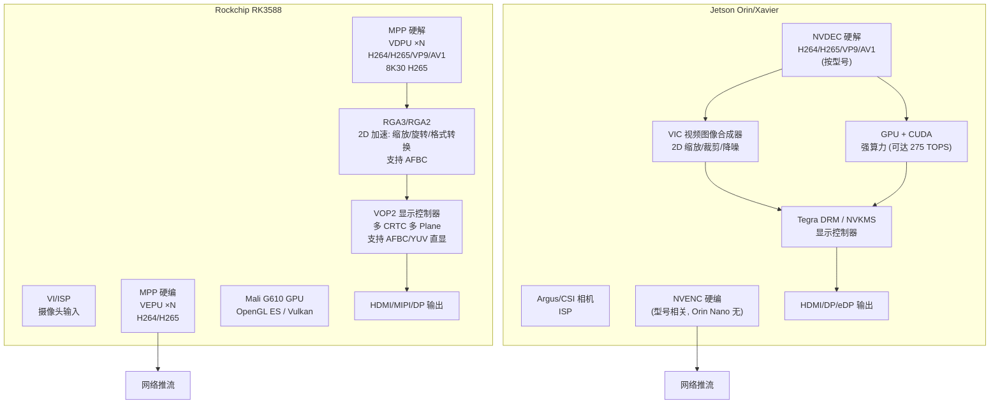

**平台差异总表**：

| 维度 | Rockchip RK3588 | Jetson Orin |
|---|---|---|
| 编解码 API | **MPP**（C API，rk_mpi）/ V4L2 request API | **Tegra V4L2**（带 NV 私有控件）/ Jetson Multimedia API / GStreamer 插件 |
| 2D 加速 | **RGA**（im2d API） | **VIC**（NvBufSurfTransform） |
| GPU | Mali G610（GLES/Vulkan，无 CUDA） | NVIDIA GPU（**CUDA** 是核心武器） |
| 显示 | 主线内核 **VOP2 DRM** 驱动（主线化程度高） | JetPack 内核 **tegra DRM/NVKMS**（NVIDIA 私有组件多） |
| 内存分配 | DMA heap / ION（旧）/ CMA | nvmap/carveout + dma-buf（新内核同样走 dma-buf） |
| 同步 | Linux 标准 **dma_fence/dma-resv**（隐式） | **syncpts**（host1x 硬件信号量）+ fence fd |
| 生态 | GStreamer（mppvideodec 等）、FFmpeg（rkmpp）、Wayland 合成器 | GStreamer nv 系列插件、DeepStream、Isaac |
| 典型瓶颈 | MPP 通道数、AFBC 兼容矩阵 | NVDEC/NVENC 引擎数量、EGLStream 遗留 |

两者的设计哲学一致：**CPU 全程只做控制流，数据以 dma-buf fd 为货币在引擎间流转**。

---

<a id="dma"></a>

# 2. DMA-BUF 与内存生命周期 ★

嵌入式多媒体系统的第一性原理：**一块内存，多方使用（解码器写 → GPU/RGA 处理 → 显示器读 → 编码器读）**。如果每换一个引擎就拷贝一次，1080p@30 NV12（约 3MB/帧）× 多个引擎 × 30fps，DDR 带宽与 CPU 都会被拷贝吃掉。所以 Linux 用 **dma-buf fd** 作为跨引擎、跨子系统的"数字货币"。

<a id="dma-buf"></a>

## 2.1 dma-buf fd 的生命周期

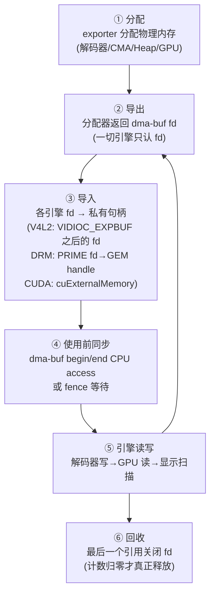

- **fd 是跨进程可传递的**（Unix domain socket / binder）——这就是 Wayland 合成器、GStreamer、多进程 IPC 共享视频帧的基础。
- **fd ≠ 内存所有权**：fd 只是访问凭证；真正的引用计数在 dma-buf 对象上，所有持有 fd（import 过）的引擎释放后才回收。
- 每个引擎 import 后得到的是**自己的私有映射**（GEM handle / NvBufSurface / device memory），fd 在内核里由 `dma-buf ops` 统一分发。

<a id="dma-alloc"></a>

## 2.2 各平台的分配器与堆

| 平台 | 分配方式 | 说明 |
|---|---|---|
| RK | **DMA heap**（`/dev/dma_heap/system`、`reserved`/CMA 堆） | 新内核标准路径；MPP 支持 `MPP_BUFFER_TYPE_DRM`（内部走 DMA heap/ION），解码输出帧直接是 dma-buf |
| RK 旧内核 | **ION**（`/dev/ion`，RK 客制） | 遗留路径，新 BSP 已迁 DMA heap |
| RK 摄像头 | ISP/VI 驱动分配，V4L2 M2M，`VIDIOC_EXPBUF` 导出 fd | 传感器→ISP→编码 全零拷贝 |
| Jetson | **nvmap/carveout**（reserved memory）→ 包装成 dma-buf | NvBufSurfaceAllocate（Jetson API）产出带 fd 的 NvBufSurface；ISC/VI 一体 |
| Jetson GPU | CUDA 分配（cudaMalloc）→ **cuExternalMemory 导入 dma-buf** | 反向：CUDA 显存也可导出（JetPack 5+ 对 NVDEC 输出帧可直接 CUDA import） |

**物理连续 vs 分散**：硬件编解码器（RK VDPU/VEPU、Tegra NVDEC）大多要求**物理连续**大内存（CMA/reserved carveout），这是启动时 `reserved-memory` 设备树节点存在的原因；GPU/SMMU 引擎可用 scatter-gather。

**对齐/步长（stride）陷阱**：每家引擎的对齐要求不同——RK 常见 16B 对齐、MPP 输出对齐 stride（如 1920 源码流实际 stride 可能是 1984）；Jetson NVDEC 输出 NV12 的 stride 按 256B 对齐（1080p 常为 2048 而非 1920）。**跨引擎传 buffer 时必须带 stride 信息**（NvBufSurfaceParams / MppFrame stride / drm fb pitch），否则花屏。

<a id="dma-cache"></a>

## 2.3 CPU 缓存一致性与同步

- 引擎（DMA 硬件）与 CPU 之间没有硬件缓存一致性 → **CPU 写完要 flush cache，CPU 读前要 invalidate cache**。
- dma-buf 标准 API：
  ```c
  struct dma_buf_sync sync = { .flags = DMA_BUF_SYNC_START | DMA_BUF_SYNC_RW };
  ioctl(dmabuf_fd, DMA_BUF_IOCTL_SYNC, &sync);   // 开始 CPU 访问（invalidate）
  ... memcpy / 修改 ...
  sync.flags = DMA_BUF_SYNC_END | DMA_BUF_SYNC_RW;
  ioctl(dmabuf_fd, DMA_BUF_IOCTL_SYNC, &sync);   // 结束（flush）
  ```
- **忘记 SYNC 是嵌入式花屏/黑屏第一名**：CPU 画完直接交给显示引擎，显示引擎读到的还是旧 DDR 内容（cache 没刷下去）。
- 引擎↔引擎（非 CPU）方向由 **fence/syncpt** 保证顺序（§7），不需要 CPU 介入。
- Jetson：nvmap 有 cache 管理接口，Jetson API 内部多数已处理；RK 裸用 drm/gbm 时要自己注意（GBM 的 `gbm_bo_map` 带读写标志会处理）。

<a id="dma-matrix"></a>

## 2.4 引擎间 import/export 能力矩阵

| 源 \ 目标 | RK MPP(编解码) | RGA | VOP2/DRM | RK GPU(Mali) | Jetson NVDEC | Jetson VIC | CUDA | Jetson DRM |
|---|---|---|---|---|---|---|---|---|
| MPP 解码帧 | ✅（内部） | ✅ dmabuf | ✅ dmabuf→fb | ✅ EGLImage/dmabuf | — | ✅ dmabuf | ✅ cuExternalMemory | ✅ |
| RGA 输出 | ✅ | — | ✅ | ✅ | — | — | （RK 无 CUDA） | ✅ |
| Jetson NVDEC 帧 | — | — | ✅（经 NvBufSurface→dmabuf） | — | ✅ | ✅ NvBufSurface | ✅（NvBufSurface→CUDA） | ✅ NvDrmRenderer |
| VIC 输出 | — | — | ✅ | — | ✅ | — | ✅ | ✅ |
| 相机 ISP（VI） | ✅ | ✅ | ✅ | ✅ | ✅ | ✅ | ✅ | ✅ |

结论：**fd 到处都能走**，但格式/AFBC/stride 兼容性是真正的限制（比如 AFBC 压缩 buffer 只有 RGA3/VOP2/部分引擎能读，CUDA 不能直接读 AFBC，需要 RGA 先解压转 NV12）。

---

<a id="decode"></a>

# 3. 解码全流程 ★

<a id="dec-rk"></a>

## 3.1 RK：MPP 解码完整链路

MPP（Media Process Platform）是 Rockchip 的统一多媒体处理框架 API。解码端到端：

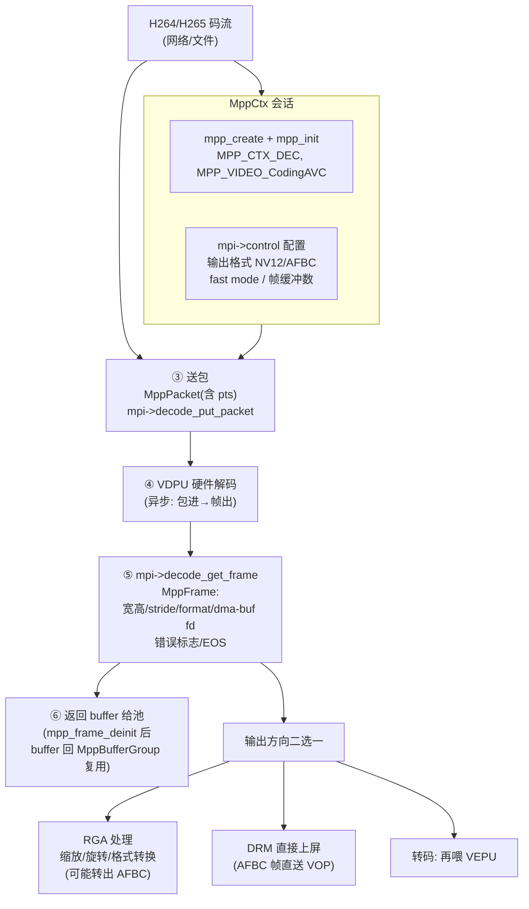

**逐帧循环的代码骨架**（精简自 mpi_dec_test）：

```c
MppCtx ctx; MppApi mpi;
mpp_create(&ctx, &mpi);
mpp_init(ctx, MPP_CTX_DEC, MPP_VIDEO_CodingAVC);        // H264
// 输出为带 dma-buf 的帧（零拷贝链路的关键开关）
MppDecCfg cfg; mpp_dec_cfg_init(&cfg);
mpp_dec_cfg_set_u32(cfg, "base:output_format", MPP_FMT_YUV420SP);   // NV12
mpi->control(ctx, MPP_DEC_SET_CFG, cfg);

// 缓冲组：MPP 内部 frame buffer 池（可用 MPP_BUFFER_TYPE_DRM 让池子从 dma-buf 分配）
MppBufferGroup frm_grp;
mpp_buffer_group_get_internal(&frm_grp, MPP_BUFFER_TYPE_DRM);
mpi->control(ctx, MPP_DEC_SET_EXT_BUF_GROUP, frm_grp);

while (running) {
    if (有输入) {
        MppPacket pkt;
        mpp_packet_init(&pkt, buf, len);
        mpp_packet_set_pts(pkt, pts);
        mpi->decode_put_packet(ctx, pkt);                // ③ 非阻塞投递
    }
    MppFrame frame = NULL;
    if (MPP_OK == mpi->decode_get_frame(ctx, &frame)) {  // ④⑤ 非阻塞取帧
        if (mpp_frame_get_eos(frame)) break;
        if (mpp_frame_get_errinfo(frame) | mpp_frame_get_discard(frame)) { /* 跳过 */ }
        int fd = mpp_buffer_get_fd(mpp_frame_get_buffer(frame));   // ★ dma-buf fd
        int stride = mpp_frame_get_stride(frame);                  // ★ 对齐后步长
        int width  = mpp_frame_get_width(frame);
        int height = mpp_frame_get_height(frame);
        // → 送 RGA / DRM plane / 编码器（全部只传 fd+stride，零拷贝）
        // ...使用完后：
        mpp_frame_deinit(&frame);            // ⑥ 引用-1，buffer 回池
    }
}
```

**关键机制详解**：
- **包与帧异步**：put_packet 与 get_frame 是**队列化**的——码流一次可能出 0~N 帧（B 帧重排）；必须**循环轮询**而非一对一假设。
- **外部 buffer 池（MPP_DEC_SET_EXT_BUF_GROUP）**：让解码输出帧从你指定的 DRM/dma-buf 池分配——这是"解码输出直接上屏"的前提。池深度按 B 帧数+渲染占用+安全余量给（通常 4~8 帧少一帧就阻塞）。
- **AFBC**：RK BSP 支持 MPP 输出 AFBC 压缩帧（`MPP_FMT_...` AFBC 变体），RGA3 与 VOP2 都能直接读 AFBC——**DDR 带宽省约 50%**（1080p NV12 约从 3MB/帧 降到 1.5MB 左右）。注意兼容矩阵：Mali 老版本/RGA2 只能解压后用。
- **动态分辨率**：流中途改分辨率（自适应流）→ get_frame 返回新宽高的帧 + info change 事件（`MPP_DEC_SET_INFO_CHANGE_READY` 应答）→ 应用必须重建 RGA/DRM fb。
- **超时与丢帧**：低延迟场景配 `MPP_DEC_SET_PARSER_FAST_MODE`、`MPP_DEC_SET_IMMEDIATE_OUT`（立即输出，不按显示序等 B 帧），延迟换显示顺序。

**RK 的 V4L2 路线**：`rkvdec/hantro` 驱动暴露 **V4L2 stateless request API**（每帧携带码流 slice 参数）——FFmpeg 的 `rkmpp`/`v4l2m2m` 可走此路；但 BSP 主推 MPP（功能全、AFBC 支持）。

<a id="dec-jetson"></a>

## 3.2 Jetson：NVDEC / Tegra V4L2 链路

Jetson 的解码有三层可选 API（自底向上）：

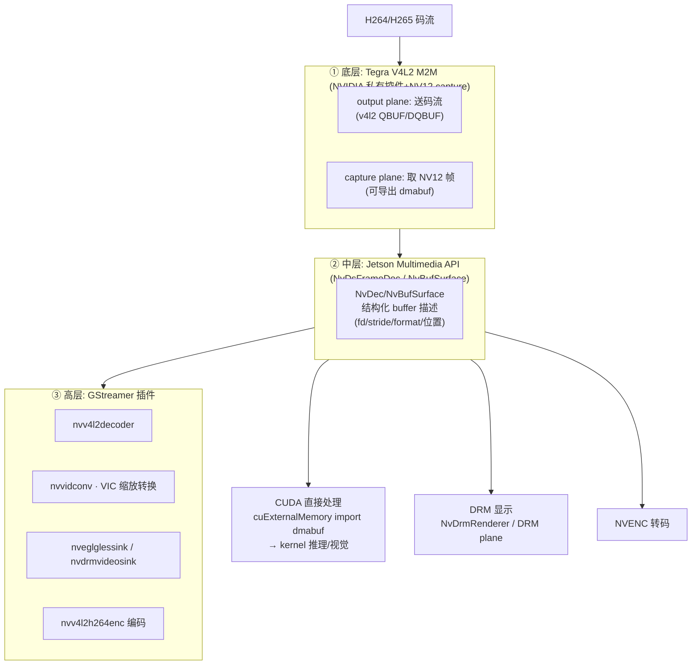

**GStreamer 典型管线**（一条命令完成"解码→CUDA 处理→上屏"）：

```bash
gst-launch-1.0 uridecodebin uri=file:///h265.mp4 ! \
  nvvideoconvert ! "video/x-raw(memory:NVMM), format=NV12" ! \
  nvdrmvideosink device-id=0 -e
```

- `memory:NVMM` 表示 buffer 在 **NVMM 显存区**（carveout），后续所有 NV 插件直接传递，零拷贝。
- **NVDEC 特性**：
  - capture plane 的 buffer 常驻（固定数量循环），`DQBUF` 取帧后**必须尽快 QBUF 还回**——池子耗尽解码器就停摆（等价于 RK 的 buffer 池深度问题）；
  - 支持动态分辨率切换（同 RK 的 info-change）；
  - 低延迟模式（`disable-dpb`、`enable-max-performance` 控件）；
  - EOS 处理（`send EOS → drain`）。
- **CUDA 导入**：NVMM buffer 的 dma-buf fd 用 `cudaExternalMemory`（`cuExternalMemoryBufferOrg` 系列）导入后，kernel 直接读写 NV12 平面——DeepStream 推理链路的标准形态。**Jetson 独有优势：RK 上没有 CUDA**，Mali 走 OpenCL/Vulkan 做同等工作但生态弱得多。
- **与 RK 的工程差异**：RK 的 MPP 是"纯 C 简洁 API"，Jetson 的 V4L2/MediaAPI 抽象层多、文档在 SDK sample 里；但 Jetson 的 CUDA 生态让解码帧→AI 推理→回写显示的整条链极其顺滑。

---

<a id="encode"></a>

# 4. 编码全流程

## 4.1 RK：MPP 编码

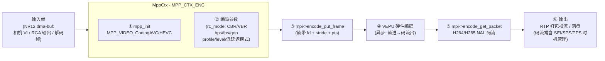

代码骨架（对照你的 video_meeting 客户端里 MF/NVENC 的位置——MPP 是 RK 上的对应角色）：

```c
MppCtx ctx; MppApi mpi;
mpp_create(&ctx, &mpi);
mpp_init(ctx, MPP_CTX_ENC, MPP_VIDEO_CodingHEVC);

MppEncCfg cfg; mpp_enc_cfg_init(&cfg);
mpp_enc_cfg_set_s32(cfg, "prep:width", 1920);
mpp_enc_cfg_set_s32(cfg, "prep:height", 1080);
mpp_enc_cfg_set_s32(cfg, "prep:format", MPP_FMT_YUV420SP);   // NV12
mpp_enc_cfg_set_u32(cfg, "rc:mode", MPP_ENC_RC_MODE_CBR);
mpp_enc_cfg_set_s32(cfg, "rc:bps_target", 4 * 1000 * 1000);
mpp_enc_cfg_set_s32(cfg, "codec:type", MPP_VIDEO_CodingHEVC);
mpi->control(ctx, MPP_ENC_SET_CFG, cfg);

// 关键：用外部 dma-buf 帧编码（VI/RGA 输出直接进编码器，零拷贝）
MppFrame frame; mpp_frame_init(&frame);
mpp_frame_set_buffer(frame, mpp_buffer_import(group, dmabuf_fd));
mpp_frame_set_width/height/stride(...);
mpp_frame_set_pts(frame, pts);
mpi->encode_put_frame(ctx, frame);               // ③

MppPacket pkt;
if (MPP_OK == mpi->encode_get_packet(ctx, &pkt)) {   // ⑤
    void *ptr = mpp_packet_get_data(pkt);            // 码流（含 NAL）
    size_t len = mpp_packet_get_length(pkt);
    int key  = mpp_packet_is_keyframe(pkt);          // 关键帧 → SEI/时间戳
    // → RTP 打包推流；用完 mpp_packet_deinit(&pkt)
}
```

**要点**：
- **码率控制 rc_mode**：CBR（恒定，直播） / VBR（质量优先） / AVBR；低延迟场景 CBR + 小 GOP + 关闭 B 帧（`codec:b_frame` 置 0，或用 only-I/P 帧结构）——B 帧重排会加 2~3 帧延迟（与你 WebRTC 客户端的低延迟编码思路一致）。
- **SEI/SPS 时机**：请求即时关键帧用 `MPP_ENC_SET_IDR_FRAME`（对应 WebRTC PLI 到达时的 ForceKeyFrame）；SPS/PPS 时机用 `MPP_ENC_GET_EXTRA_INFO` 获取，注意"每个 IDR 前插参数集"（你客户端的 spsPps 缓存逻辑在 RK 上同样需要）。
- **多路并发**：RK 的 VEPU 是独立硬件引擎，多实例编码（多 MppCtx）可并行跑不同 VEPU/分时复用；通道总数与 4K/8K 能力按 SoC datasheet（RK3588 支持 8K30 H265 编码 + 多路 1080p 并行）。
- **性能调优**：`MPP_ENC_SET_SEI_CFG`（插入自定义 SEI）、split-parse、多线程轮询多个 ctx（每路一个线程或一个线程轮询多 ctx）。

## 4.2 Jetson：NVENC

两条路径：

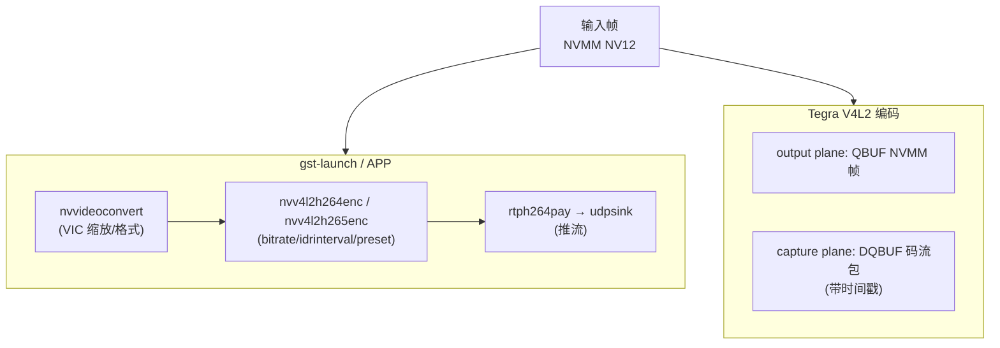

```bash
gst-launch-1.0 v4l2src device=/dev/video0 ! \
  "video/x-raw, width=1920, height=1080, framerate=30/1" ! \
  nvvideoconvert ! "video/x-raw(memory:NVMM)" ! \
  nvv4l2h264enc bitrate=4000000 insert-sps-pps=true idrinterval=30 \
    maxperf-enable=1 preset-level=1 ! \
  h264parse ! rtph264pay ! udpsink host=192.168.1.10 port=5000
```

- **NVENC 特性**：码率控制（CBR/VBR/ConstQP）、插入 SPS/PPS、**IDR 请求**（WebRTC PLI → `I-frame interval` 或动态 `ForceIDR` 控件）、低延迟 preset（`preset-level=1` 低延迟主档）、**无 B 帧**默认。
- **引擎数量限制**：NVDEC/NVENC 是有限硬件资源——Orin AGX/Xavier 有 NVENC，**Orin Nano 无 NVENC**（只能软编/CUDA 编码）；多路并发按引擎吞吐排队（GStreamer 会串行等待）。
- **多路转码的典型架构**：NVDEC ×N 解 → VIC 统一缩放到目标布局 → NVENC 合成单流（如 9 宫格监控上墙），全程 NVMM 零拷贝。
- **RK vs Jetson 编码一句话对比**：MPP API 裸但直给（适合自研协议栈/你的 mediasoup 客户端这类原生实现），Jetson 走 GStreamer/V4L2 全家桶（生态强、上手快、CUDA 前处理无敌）。

---

<a id="drm"></a>

# 5. 渲染：DRM/KMS 深入

DRM（Direct Rendering Manager）是 Linux 的图形子系统：**KMS**（Kernel Mode Setting，显示控制）+ 渲染管理。嵌入式"直接上屏"的本质是：**把一块 dma-buf 包装成 DRM Framebuffer，交给显示控制器（KMS）按刷新率扫描输出**——全程无 GPU 合成、无窗口系统。

<a id="drm-kms"></a>

## 5.1 KMS 对象模型：CRTC / Plane / Encoder / Connector

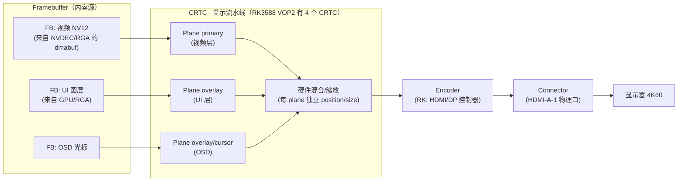

- **CRTC**：一条显示流水线（RK3588 VOP2 有 4 条：可同时驱动 HDMI×2 + MIPI + DP）。
- **Plane**：硬件图层，**每个 plane 独立绑定一个 framebuffer、独立缩放/位置/格式**——视频层用 YUV plane（NV12/AFBC 直显，无 GPU 参与），UI 用 ARGB plane，硬件混合后输出。**plane 数量与能力（能否 AFBC/YUV/旋转）是嵌入式显示选型的硬约束**。
- **Encoder/Connector**：时序生成与物理口（HDMI/DP/MIPI-DSI），connector 携带 EDID/状态。
- RK3588 的 VOP2 层级：Cluster window（高性能，支持 AFBC+旋转）> Esmart（缩放）> Smart（轻量）——视频帧要绑对 window 类型。
- Jetson：tegra DRM 同样是 CRTC/plane 模型（head/plane），但驱动私有多；用户态可用标准 DRM API（`/dev/dri/card0`），或 NVIDIA 的 NVKMS/EGL 叠加。

**查看硬件能力**：`modetest -M rockchip`（RK）/ `modetest -M tegra`（Jetson）列出所有 CRTC/plane/connector 及支持的格式——写渲染代码前先跑一遍。

<a id="drm-prime"></a>

## 5.2 GEM / PRIME：缓冲从解码器到屏幕

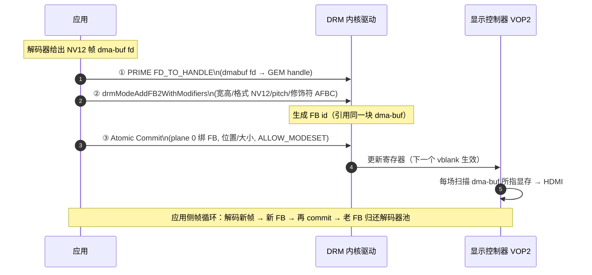

- **GEM handle**：进程内对显存对象的句柄（DRM_IOCTL_PRIME_FD_TO_HANDLE 从 dma-buf 导入；同进程重复导入同一 fd 得同一 handle）。
- **drmModeAddFB2WithModifiers**：把"格式 + 三个平面 pitch + 修饰符（AFBC 等）"注册成 FB——**modifier 必须与 buffer 实际格式完全一致**（AFBC 帧报成线性 → 显示花屏）。
- **导入校验**：VOP2 会检查 plane 能力（格式/尺寸/对齐/AFBC 支持），不满足 commit 报 EINVAL——**先 TEST_ONLY commit 预检**。
- YUV 直显：NV12 FB 直接给 plane（硬件做 YUV→RGB 色彩转换），省一次转换——RK/Jetson 的 plane 都支持 NV12/YUV420。

<a id="drm-atomic"></a>

## 5.3 Atomic API：一次提交换帧

传统 legacy API（`drmModeSetPlane` 多次调用）存在**撕裂窗口**（各 plane 不同步生效）；**Atomic** 是现代标准：

```c
drmModeAtomicReq *req = drmModeAtomicAlloc();
// plane 绑新 FB + 位置 +（可选）in-fence
drmModeAtomicAddProperty(req, plane_id, prop_fb_id, fb_id);
drmModeAtomicAddProperty(req, plane_id, prop_crtc_id, crtc_id);
drmModeAtomicAddProperty(req, plane_id, prop_src_x, 0);
// ... 需要的属性（fb_id/crtc_id/src_*/crtc_*）
uint32_t flags = DRM_MODE_ATOMIC_NONBLOCK | DRM_MODE_PAGE_FLIP_EVENT;
drmModeAtomicCommit(drm_fd, req, flags, user_data);   // 一次原子提交

// vblank 事件循环（select/poll 在 drm fd 上）
// drmHandleEvent → page_flip_handler: 上一帧已上屏
//   → 归还旧 fb 给解码器池 → 解码下一帧 → 再次 commit
```

- **原子性**：一次 commit 同时更新多个 plane（视频层+UI 层同 vsync 生效），失败整体回滚。
- **NONBLOCK + PAGE_FLIP_EVENT**：提交后不阻塞，vblank 到来触发事件——**这是双/三缓冲循环的事件驱动核心**（§6）。
- **fence 集成**：commit 可带 `IN_FENCE_FD`（内容还没写完？显示引擎等 fence 再扫描）与 OUT_FENCE_PTR（取回"本次提交何时生效"的 fence）——与 §7 的 sync 无缝衔接。
- **TEST_ONLY**：干跑校验（不真提交），用于分辨率/位置变化的预检。

---

<a id="buffering"></a>

# 6. 双缓冲 vs 三缓冲 ★

**为什么需要多缓冲**：显示控制器按刷新率**异步扫描**显存（60Hz = 每 16.6ms 扫一遍），而生产者（GPU/解码器/CPU）**异步写**。如果"写的 buffer"正是"正在扫描的 buffer" → **撕裂**（上半屏新内容、下半屏旧内容）。多缓冲的本质：**写入与扫描永远指向不同 buffer，vblank 时刻原子切换**。

## 6.1 双缓冲（Double Buffering）

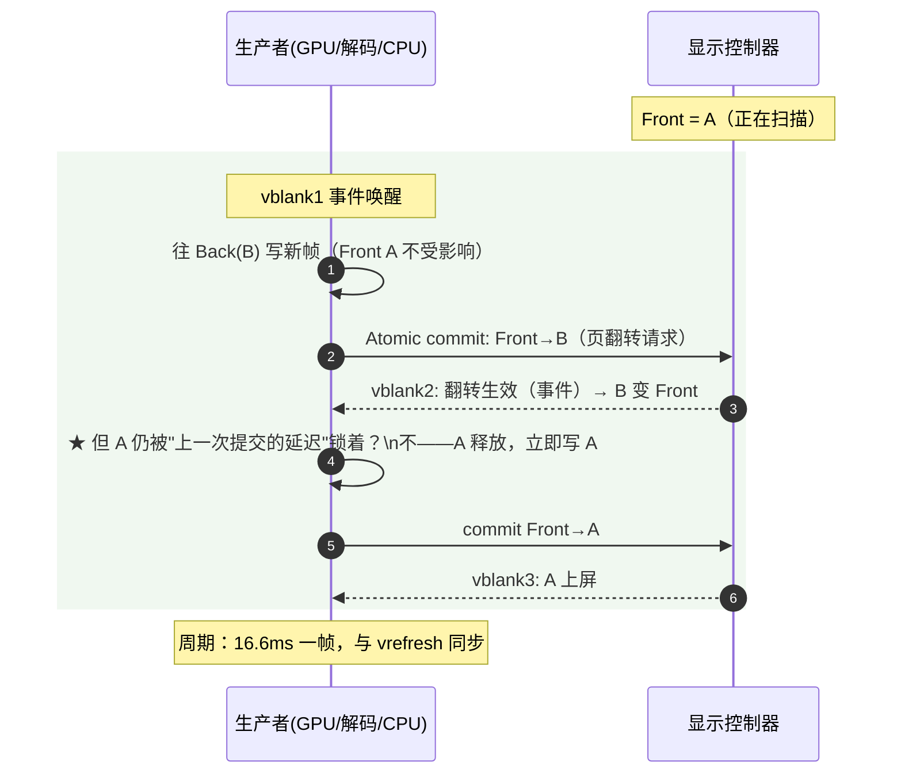

**双缓冲的问题——写时间超过一个刷新周期时卡顿**：
- 生产者必须在"Back buffer 空闲"时才能开始画。双缓冲只有一个 Back；
- 如果绘制耗时 > 16.6ms（帧率 < 刷新率），会出现：commit 请求发出 → 等下一个 vblank 才翻转 → 这期间 Back 被锁住（不能写）→ 生产者**空等一个周期** → **实际帧率掉到刷新率的一半（30fps）并周期性抖动**——"掉帧胶水"现象。

## 6.2 三缓冲（Triple Buffering）

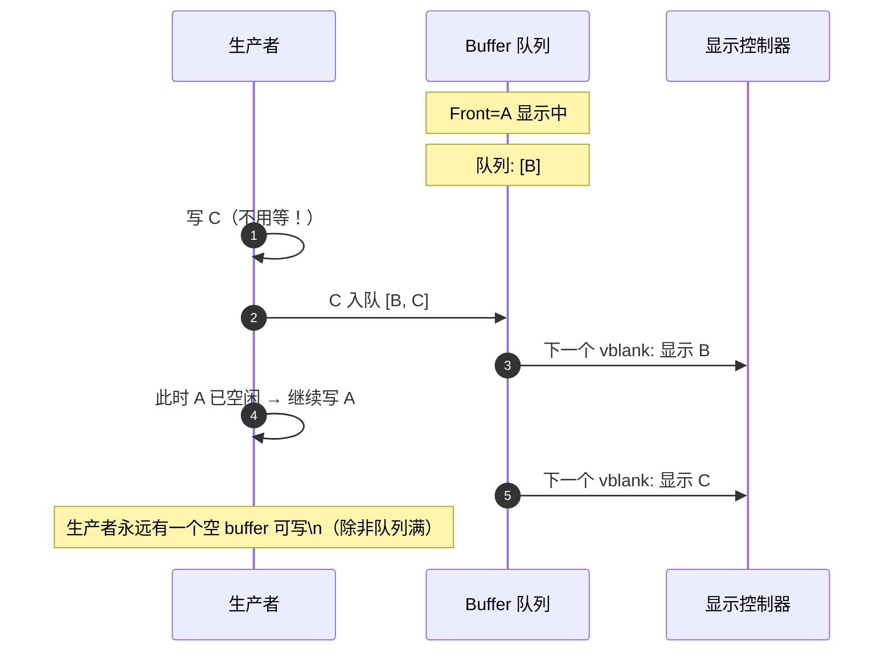

**三缓冲的本质**：在"显示中"与"写入中"之间加一个**深度为 1 的 pending 队列**：
- 生产者把画好的帧**丢进队列就走人**，不需要等它被显示——绘制节奏与 vblank **解耦**；
- 即使某帧绘制超时，队列里还有一帧存货可显示，**不会出现"空等一个周期"的胶水卡顿**，帧时间更平滑（小帧率波动被队列吸收）；
- **代价：显示延迟 +1 帧**（从队列取出到上屏多等一个 vblank，~16.6ms）——交互类应用（游戏/触控）对输入延迟敏感时要权衡；对视频播放/监控预览则几乎无感。
- 内存代价：多一块全尺寸 framebuffer（4K NV12 ≈ 12MB，ARGB8888 ≈ 33MB）。

## 6.3 对比总结

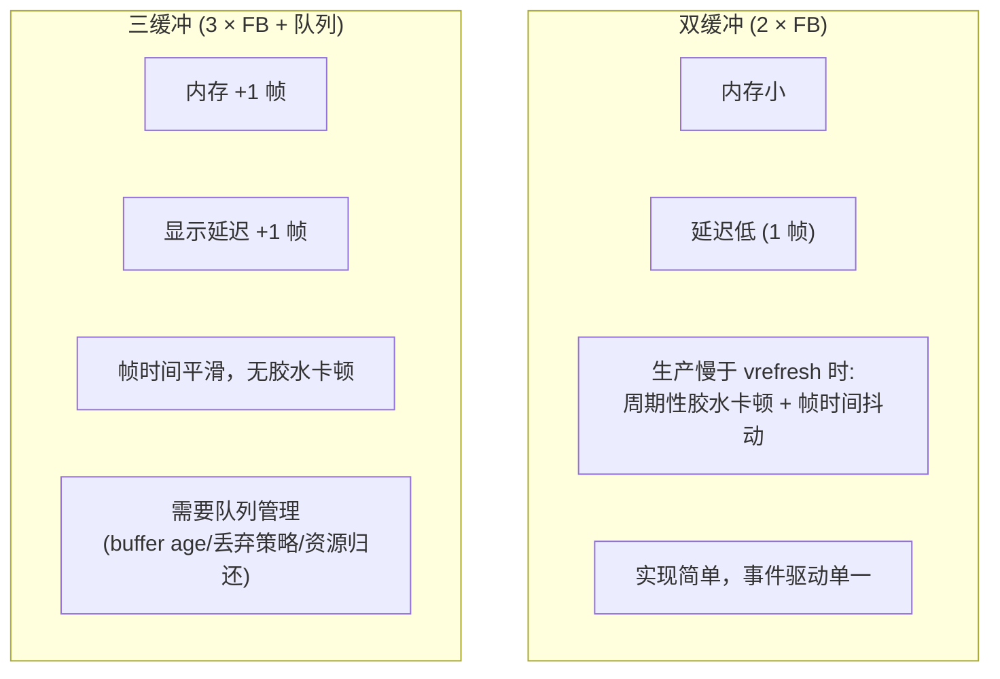

| 维度 | 双缓冲 | 三缓冲 |
|---|---|---|
| 内存 | 2 × FB | 3 × FB |
| 显示延迟 | 最低（1 帧） | +1 帧（~16.6ms @60Hz） |
| 生产耗时 < vrefresh 周期 | 两者表现一致 | 两者一致 |
| 生产耗时 > vrefresh 周期 | **周期性胶水卡顿**（帧率锁半） | 平滑掉帧（帧率略降但不抖） |
| 适用 | 帧率稳、低延迟硬实时（视频逐帧上屏） | 渲染时长有波动的应用（GPU 合成、动画） |
| 典型场景 | 视频播放（解码节奏可控）、简单 OSD | 合成器、游戏、复杂 UI 动画 |

**实现要点（EGL/GBM/DRM 路径，两平台通用）**：

```c
// GBM 分配 N 个 buffer（N=2 双缓冲，N=3 三缓冲）
for (i = 0; i < N; i++)
    bo[i] = gbm_bo_create(gbm_dev, w, h, GBM_FORMAT_ARGB8888,
                          GBM_BO_USE_RENDERING | GBM_BO_USE_SCANOUT);
// EGL surface 上渲染（无窗口系统时用 EGL_PLATFORM_GBM_MESA）
eglSwapBuffers(egl_dpy, egl_surf);
gbm_bo *bo = gbm_surface_lock_front_buffer(gbm_surf);   // 取前缓冲
fb_id = fb_for_bo(bo);                                  // 复用已注册 FB
drmModeAtomicCommit(..., fb_id, PAGE_FLIP_EVENT ...);   // 提交
// page_flip_handler 里：gbm_surface_release_buffer(gbm_surf, old_bo);  // 归还队列
```

- **视频帧上屏的特例**：视频不需要"绘制"，解码帧直接 commit（可视为"零耗时生产者"）——此时**双缓冲就够**且延迟最优（你的 mediasoup 客户端 D3D11 交换链在 RK/Jetson 上对应 GBM/DRM 直显路径）；
- **帧率与刷新率不同步**（30fps 内容 @60Hz 显示）：要么 commit 每两帧一次（3:2 节奏），要么用 plane 的重复扫描（同一 FB 挂两场）——帧节奏管理是"丢帧还是抖动"的选择；
- **vsync 关闭**（`--allow-tearing` 等价物）：NONBLOCK commit 不等 vblank → 最低延迟但撕裂（你 WebRTC 客户端已有同名开关，嵌入式上对应 `DRM_MODE_ATOMIC` 不带 vblank 等待或直接 SetPlane legacy）。

---

<a id="sync"></a>

# 7. Sync 跨引擎同步机制 ★

流水线上引擎是**异步**的：解码器还没写完这块 dma-buf，RGA 就去读 → 读到半张图；GPU 还没画完，显示控制器就去扫 → 撕裂。**Sync 的使命：把"操作完成"这个事实跨引擎、跨进程传递**。

## 7.0 问题模型

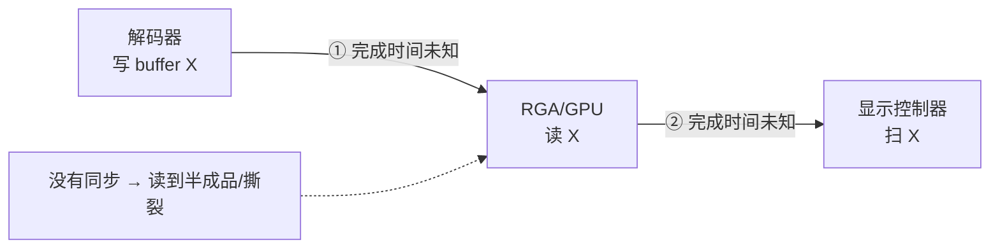

Linux 通用解：**dma_fence（栅栏）→ sync_file（fence fd）→ dma-resv（buffer 上的栅栏集合）**。

<a id="sync-rk"></a>

## 7.1 RK：dma_fence / dma-resv 隐式同步

**dma-resv（reservation object）**：每块 dma-buf 内置一个栅栏集合，**隐式同步的根基**：
- 写者完成时挂 **exclusive fence**（如解码器把"帧写完"fence 挂上去）；
- 读者使用前查 resv：有未触发的 fence 就**先等它**（GPU 提交时把 fence 一起交给硬件，硬件排队）；
- 一切自动化——**应用甚至不感知**，这就是"隐式同步"。

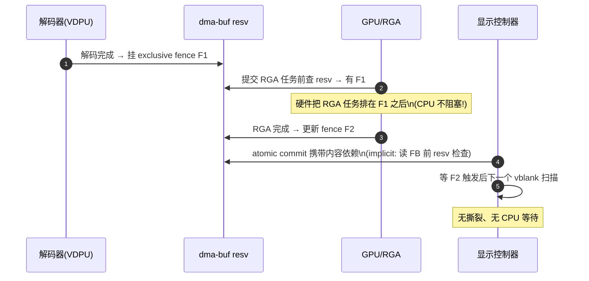

- **显式路径**（需要精确控制时）：
  - `SYNC_IOC_MERGE`：合并多个 fence 成一个 sync_file；
  - EGL：`eglCreateSyncKHR(EGL_SYNC_NATIVE_FENCE_ANDROID)` 取 fence fd → `eglWaitSyncANDROID`；
  - DRM Atomic：`IN_FENCE_FD`（内容 fence）/ `OUT_FENCE_PTR`（提交 fence）；
  - V4L2：`VIDIOC_QBUF`/`DQBUF` 可携带 fence fd（新内核 request/fence 扩展）。
- **RK 的现实**：主线内核 dma-resv 机制由各驱动（rockchipdrm/panfrost/RGA）实现；**AFBC/部分老驱动隐式同步覆盖不全时**，应用要自己插 EGL fence 或用 CPU 同步兜底（这是 RK 生态偶发撕裂/竞态的来源）。

<a id="sync-jetson"></a>

## 7.2 Jetson：syncpts 与硬件信号量

Jetson 的同步不走通用 dma_fence 一层皮，而是 **host1x 硬件通道上的 syncpt（同步点）**：

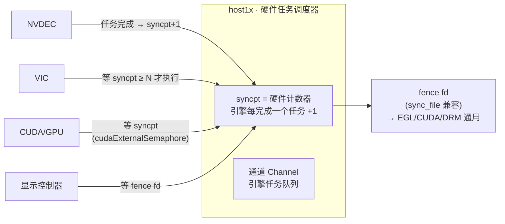

- **syncpt = 硬件自增计数器**：NVDEC 完成 1 帧 → 计数 +1；VIC 的任务描述符里带"等 syncpt 达到 N"的条件 → **硬件级顺序保证，零 CPU 参与**；
- 用户态：`/dev/nvhost-ctrl` 的 ioctl 读写/等待 syncpt；JetPack 把 syncpt 包装成 **fence fd（sync_file 兼容）**，于是 EGL（`EGL_SYNC_CUDA_EVENT_NV` / native fence）、CUDA（`cudaExternalSemaphore`）、DRM（in-fence）都能消费；
- **CUDA 互操作**：解码帧 → CUDA kernel 前用 external semaphore 等解码 fence；写完再挂新 fence 给显示——DeepStream 的流水线正确性依赖这条链；
- **NvBufSurface 的同步**：`NvBufSurfTransform` 提交带同步参数；CPU 访问前用 `NvBufSurfaceSyncForCpu/Device`（等价 DMA_BUF_IOCTL_SYNC）。

<a id="sync-implicit"></a>

## 7.3 隐式 vs 显式同步对比

| 维度 | 隐式（dma-resv 自动） | 显式（fence fd 手动传递） |
|---|---|---|
| 开发成本 | 零（框架自动） | 高（每步要拿/传/等 fd） |
| 粒度 | 每块 buffer 一份栅栏集 | 可精确到"每帧/每次提交" |
| 多线程多队列 | 容易过同步或漏同步 | 精确建模依赖图 |
| 平台支持 | Linux 通用 | 需各引擎/驱动支持 fence fd |
| 典型问题 | **漏挂 fence → 竞态撕裂**（驱动覆盖不全） | 传错 fd/忘等 → 同样竞态，但可复现 |

**实践准则**：
1. 引擎↔引擎全硬件链路：优先隐式（RK）或平台 API（Jetson syncpt），CPU 不参与；
2. 引入新引擎/自定义 V4L2 驱动时：**显式 fence 走起来**（QBUF/DQBUF fence、DRM in-fence），宁多勿漏；
3. CPU 访问任何 dma-buf 前后：begin/end SYNC（§2.3）——隐式 fence 只保引擎顺序，**不保 CPU cache**；
4. 排查竞态：先把隐式换成显式 fence，问题往往立刻显形（ fence 时序一眼可见）。

---

<a id="e2e"></a>

# 8. 端到端整合与常见坑

<a id="e2e-link"></a>

## 8.1 两条完整零拷贝链路对比

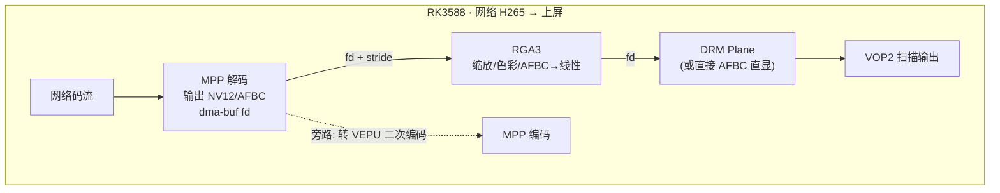

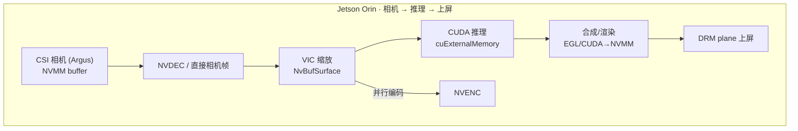

| 链路环节 | RK | Jetson |
|---|---|---|
| 内存分配 | DMA heap / MPP DRM 池 | nvmap/NVMM + NvBufSurface |
| 解码输出 | MppFrame → fd | NvBufSurface → fd（NVMM） |
| 2D 处理 | RGA（im2d） | VIC（NvBufSurfTransform） |
| AI 前处理 | Mali（OpenCL/Vulkan，生态弱） | **CUDA**（生态碾压） |
| 上屏 | VOP2 DRM atomic | tegra DRM / NvDrmRenderer |
| 同步 | dma-resv 隐式 + 显式 fence | syncpts → fence fd |
| 开发形态 | MPP 裸 C API + 自研管道 | GStreamer 全家桶 + CUDA 生态 |

<a id="e2e-tools"></a>

## 8.2 调试工具清单

| 工具 | 平台 | 用途 |
|---|---|---|
| `modetest -M rockchip` / `-M tegra` | 双平台 | 列出 CRTCs/planes/connector 能力；手动投一块 buffer 上屏（验证 DRM 链路） |
| `modetest -P`（set plane） | 双平台 | 手动绑 plane/fb 测显示路径 |
| `/sys/kernel/debug/dri/0/state` | 双平台 | KMS 当前状态 dump（plane 绑定/格式/位置） |
| `v4l2-ctl --list-formats-ext -d /dev/videoN` | 双平台 | 探测各 video 节点能力（分清哪个是 MPP/V4L2/ISP） |
| `mpi_dec_test / mpi_enc_test`（MPP demo） | RK | MPP 最小验证：排除应用逻辑问题 |
| `im2d_api` 示例 + `RGA` debugfs | RK | RGA 任务日志/失败原因 |
| `gst-launch-1.0 -v` + `GST_DEBUG=*:3` | 双平台 | GStreamer 全链路日志 |
| `tegrastats` / `jtop` | Jetson | NVDEC/NVENC/VIC/GPU 利用率、EMC 带宽实时曲线 |
| `rkdeveloptool` / `perf top`、`cat /proc/interrupts` | RK | 引擎中断频率（解码负载观测） |
| `strace -e ioctl` | 双平台 | 追 V4L2/DRM ioctl 序列（排查 QBUF/commit 行为） |
| `cuda-gdb` / `nsys` | Jetson | CUDA 侧核函数与流时序 |
| `dmesg` | 双平台 | dma-buf 分配失败/fence 超时/AFBC 违规告警 |

<a id="e2e-pitfalls"></a>

## 8.3 常见坑速查表

| 现象 | 根因 | 处理 |
|---|---|---|
| **CPU 处理后上屏花屏/旧内容** | 忘了 `DMA_BUF_IOCTL_SYNC`（cache 未刷） | CPU 写后 END SYNC（§2.3） |
| **画面绿屏/错位条纹** | stride 对齐不符（RK 16B / Jetson 256B 对齐） | 全链路带 stride，AddFB2 用真实 pitch |
| **图像碎块乱纹（解压失效）** | AFBC buffer 当线性 buffer 用 / modifier 没传 | AddFB2WithModifiers 带 AFBC modifier；确认引擎 AFBC 能力 |
| **解码到一半停住** | 输出 buffer 池耗尽（帧没归还） | 归还帧（mpp_frame_deinit / QBUF），池深 4~8 帧 |
| **分辨率切换后崩/花屏** | 动态分辨率未处理 info-change | 重建 RGA 目标/DRM FB（§3.1） |
| **随机撕裂** | 隐式 fence 覆盖不全 / 未用 atomic commit | 显式 fence + DRM atomic（§7.3） |
| **偶发黑屏一帧** | plane 引用了已归还的 FB（生命周期竞态） | FB 归还放在 page_flip_handler 之后 |
| **commit 报 EINVAL** | plane 能力不满足（格式/尺寸/位置超限） | 先 TEST_ONLY 预检，查 modetest 能力表 |
| **Jetson 上 EGLStream 警告** | 老 API 与新 JetPack 不匹配 | 迁到 GBM/DRM 或 NvBufSurface 路径 |
| **RK 上多路解码丢帧** | VDPU 通道/带宽超限 | 查 SoC 能力表，降路数/分辨率，AFBC 省带宽 |
| **Jetson 多路编码排队** | NVENC 引擎吞吐上限 / 型号无 NVENC | Orin Nano 无 NVENC；按引擎数规划 |
| **CPU 占用异常高** | 走了内存拷贝链（memcpy 每帧） | 检查是否漏用 dma-buf fd、误做 YUV→RGB |

---

## 结语：一句话串起全部

> **解码器把 dma-buf fd 吐出来 → RGA/VIC 用 fd 做硬件 2D → DRM plane 用 fd 直接扫描上屏；每个引擎用 fence/syncpt 保证"上一棒写完才动"，应用用双/三缓冲保证"扫描和写入永不相遇"，CPU 只在需要时用 SYNC ioctl 碰一下缓存。** 整个系统没有一次多余的内存拷贝，这就是嵌入式多媒体的正确打开方式。

各平台差异只是"引擎名字和 API 形状"：RK 的 MPP/RGA/VOP2 ↔ Jetson 的 NVDEC/VIC/DRM，模式完全同构。掌握 fd 流转 + 生命周期 + 同步三件事，换任何 SoC（全志/晶晨/地平线）都是同一套思维。

