# ROS2 架构与网络模型详解

> 覆盖：总体架构 → 组成结构（软件栈/包系统/节点内部/executor/四大通信原语/lifecycle/launch）→ 网络模型（DDS 发现机制/RTPS 端口/QoS/零拷贝/跨网段组网/ROS1 对比）→ 常用命令 → 当前不足。
> 图均为 Mermaid；版本以 ROS 2 Humble/Iron/Jazzy 为主，Kilted(2025) 的 Zenoh 变化单独标注。

---

## 目录

- [1. 总体架构](#arch)
- [2. 组成结构 ★](#comp)
  - [2.1 软件栈逐层解剖](#comp-stack)
  - [2.2 工作空间、包与构建体系（ament/colcon/rosdep）](#comp-pkg)
  - [2.3 节点内部结构：Executor 与回调组 ★](#comp-node)
  - [2.4 四大通信原语（topic/service/action/parameter）](#comp-primitives)
  - [2.5 组件化与进程内通信（composition/intra-process）](#comp-ipc)
  - [2.6 生命周期节点（Lifecycle Node）](#comp-lifecycle)
  - [2.7 Launch 系统](#comp-launch)
- [3. 网络模型 ★](#net)
  - [3.1 无中心发现机制（SPDP/SEDP）★](#net-discovery)
  - [3.2 RTPS 端口模型与 Domain](#net-ports)
  - [3.3 数据面：可靠/尽力传输、组播与分片](#net-dataplane)
  - [3.4 service/action 在网络层的真实形态](#net-svc)
  - [3.5 QoS 全解析与匹配规则 ★](#net-qos)
  - [3.6 共享内存与零拷贝](#net-shm)
  - [3.7 跨网段/云/VPN 组网（Discovery Server/Zenoh）](#net-wan)
  - [3.8 ROS1 vs ROS2 网络模型对比](#net-ros1)
- [4. 常用命令](#cli)
  - [4.1 工作空间与构建](#cli-build)
  - [4.2 ros2 CLI 全家福](#cli-cmd)
  - [4.3 关键环境变量](#cli-env)
- [5. 当前不足 ★](#issues)

---

<a id="arch"></a>

# 1. 总体架构

ROS2 = **一套分布式机器人应用框架**，底层把通信完全委托给 **DDS**（Data Distribution Service，工业级 pub/sub 中间件标准），上层用客户端库把它包装成 Node/Topic/Service 这些机器人友好的概念。

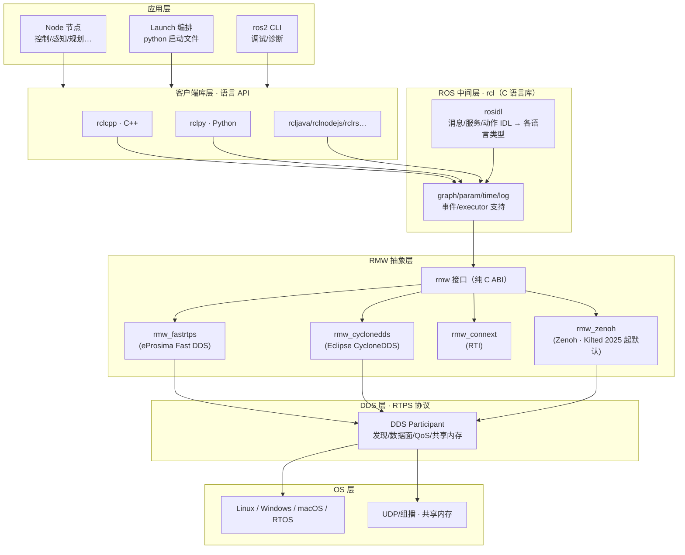

三条主线读法：
- **纵向**：应用 → rclcpp/rclpy → rcl → rmw → DDS → OS。`rmw` 是 ABI 边界——**换 DDS 供应商不用改应用代码**（`RMW_IMPLEMENTATION=rmw_cyclonedds_cpp` 切换）。
- **生态位置**：ament（构建规则）+ colcon（构建工具）+ rosdep（依赖）管"怎么编译安装"；Launch 管"怎么启动编排"；ros2cli 管"怎么调试"。
- **与 ROS1 的根本差异**：无 Master、无 XML-RPC，**发现/传输全部下沉到 DDS 标准**——这是理解 ROS2 网络模型（§3）的钥匙。

---

<a id="comp"></a>

# 2. 组成结构 ★

<a id="comp-stack"></a>

## 2.1 软件栈逐层解剖

自底向上逐层说清楚"每一层是什么、谁写的、为什么存在"：

| 层 | 内容 | 关键点 |
|---|---|---|
| **OS 层** | Linux（Ubuntu 22.04/24.04 官方）、Windows、macOS；socket/组播/共享内存 | 实时性靠 PREEMPT_RT + 调度策略（SCHED_FIFO） |
| **DDS/RTPS** | Fast DDS、CycloneDDS、Connext、Zenoh（非标准 DDS 但挂 rmw 接口） | 真正干活的通信引擎：发现、QoS、分片、可靠性 |
| **rmw 层** | `rmw` 纯 C 接口 + 各家实现（rmw_fastrtps_cpp 等） | **ABI 边界**：rcl 只认 rmw 接口 |
| **rcl 层** | C 语言核心库：节点图、参数、时钟、日志、事件、生命周期 | 与语言无关的"ROS 语义"实现 |
| **rosidl** | 接口描述（.msg/.srv/.action）→ 生成 C/C++/Python 类型与序列化代码 | 编译期代码生成；`ros2 interface show` 查看产物 |
| **客户端库** | rclcpp（C++）、rclpy（Python） | Executor、callback group、QoS 映射都在这层 |
| **应用/工具** | 你的节点、ros2cli、launch、rosbag2、rqt、robot_state_publisher 等生态包 | — |

**rosidl 类型生成管线**（理解"消息到底是什么"）：


- 消息本质：**生成的 POD 结构体 + 序列化函数**（CDR 序列化，DDS 标准）。`ros2 interface show sensor_msgs/msg/Image` 可看生成前的定义。
- typesupport 是连接 DDS 的桥：publisher 发的是 CDR 序列化后的字节流，DDS 不理解语义只按 topic 名转发。

<a id="comp-pkg"></a>

## 2.2 工作空间、包与构建体系

**包（package）** 是 ROS2 的最小分发单元，两种风格：

```text
ament_cmake 包（C++）                ament_python 包（Python）
my_pkg/                             my_py_pkg/
├── CMakeLists.txt    ← 构建/安装规则├── setup.py / pyproject.toml
├── package.xml       ← 清单(依赖声明)├── setup.cfg
├── include/my_pkg/                  ├── resource/my_py_pkg
├── src/*.cpp                        ├── my_py_pkg/（源码）
├── msg/*.msg  srv/  action/         ├── launch/*.py
└── launch/*.py                      └── test/
```

构建管线：

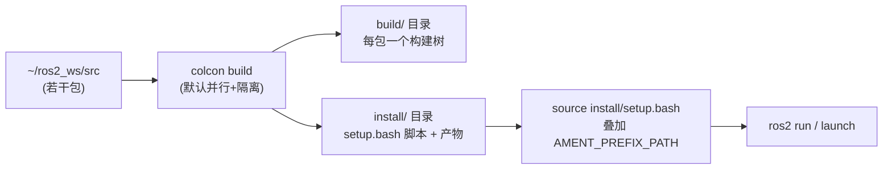

- **colcon**：构建工具（语言无关），`colcon build --symlink-install --packages-select my_pkg`；`colcon test` 跑测试。
- **ament**：构建规则/约定（ament_cmake 给 CMake 加 ROS2 宏，如 `ament_target_dependencies`、`rclcpp_components_register_node`）。
- **package.xml 依赖三段**：build_depend / exec_depend / test_depend（rosdep 依据它自动装系统依赖：`rosdep install --from-paths src`）。
- **Overlay 工作空间**：多个 ws 叠加（下层 install 被 source，上层覆盖同名包）——官方维护分层（underlay=发行版，overlay=自己的代码）。

<a id="comp-node"></a>

## 2.3 节点内部结构：Executor 与回调组 ★

一个 ROS2 节点不等于线程；**回调怎么调度由 Executor 决定**——这是 ROS2 与 ROS1（每回调一个线程池+全局互斥）在并发模型上的最大变化。

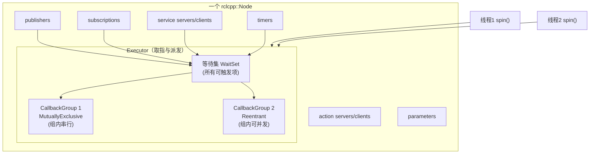

- **WaitSet 语义**：executor 每轮收集"就绪的回调"（有新消息/定时器到点/服务请求到达），按 callback group 过滤，再派发给线程。
- **CallbackGroup 两种**：
  - `MutuallyExclusive`（默认）：组内回调**同一时刻只有一个执行**——同组回调天然互斥，无需再加锁；
  - `Reentrant`：组内可多线程并发——允许同一回调并发执行（要自己保证线程安全）。
- **Executor 三种**：
  - `SingleThreadedExecutor` / `rclcpp::spin(node)`：单线程跑所有回调（默认）；
  - `MultiThreadedExecutor(n)`：n 线程并发取回调，跨组可并行、组内仍受组语义约束；
  - `StaticSingleThreadedExecutor`：静态优化版（减少 waitset 重建，高频小消息场景更快）。
- **回调里禁止阻塞**（会拖死整组）——长耗时任务用专用线程/线程池 + 事件发布解耦。
- 默认全局 executor：`rclcpp::spin`；手动写 `rclcpp::executors::MultiThreadedExecutor executor; executor.add_node(node); executor.spin();` 的场景：回调计算重、需要并行。
- Python 侧 rclpy 同构（ReentrantCallbackGroup/MutuallyExclusiveCallbackGroup），但 GIL 使多线程并行度受限。

**面试式要点**：同一个 MutuallyExclusive 组里的"定时器回调"和"订阅回调"会互相阻塞——把高频传感器回调与低频控制回调分进**不同组**，是控制延迟的第一手段。

<a id="comp-primitives"></a>

## 2.4 四大通信原语

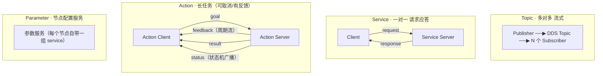

| 原语 | 语义 | DDS 形态 | 典型 QoS |
|---|---|---|---|
| Topic | 流式、无应答、多对多 | 一对 DDS reader/writer | Sensor：BEST_EFFORT+KEEP_LAST(1~5)；控制：RELIABLE |
| Service | 请求-响应、一对一 | request/response 两个 DDS 流（RMW 实现各异，§3.4） | RELIABLE |
| Action | 长任务：goal/feedback/result/status | **由 topic+service 组合实现**（goal/result=service，feedback/status=topic） | 混合 |
| Parameter | 节点配置的读写/描述/批量 | 节点自带的标准 service（set/get/list…） | RELIABLE |

四大件在代码里的对应（rclcpp）：

```cpp
auto pub  = node->create_publisher<sensor_msgs::msg::Image>("camera/image", rclcpp::QoS(5));
auto sub  = node->create_subscription<sensor_msgs::msg::Image>(
              "camera/image", rclcpp::SensorDataQoS(),
              [this](sensor_msgs::msg::Image::SharedPtr m) { /* ... */ });
auto srv  = node->create_service<std_srvs::srv::Trigger>(
              "start", [this](auto&& req, auto&& res) { res->success = true; });
auto cli  = node->create_client<std_srvs::srv::Trigger>("start");
auto act  = rclcpp_action::create_server<MoveBaseAction>(node, "move",
              handle_goal, handle_cancel, handle_accepted);
node->declare_parameter("gain", 1.0);            // 参数=自带服务
auto gain = node->get_parameter("gain").as_double();
```

<a id="comp-ipc"></a>

## 2.5 组件化与进程内通信

**问题**：每节点一个进程 → 消息走 DDS（序列化+网络/共享内存）；同一机器上高频大消息（点云/图像）白白多一次序列化+拷贝。

**组件化（Composition）**：
- 把节点写成**动态库**（`rclcpp_components_register_node`），运行时加载进 **component_container** 进程；
- 同容器内的节点走 **Intra-Process Communication（IPC）**：publisher 发布 `std::unique_ptr<Msg>` 时**零拷贝**——指针直接移交 subscription（要求 QoS 兼容、同进程、分配器一致）；
- 代价：同容器节点崩溃会连坐（进程级隔离性下降），需要按"故障域"划分容器。

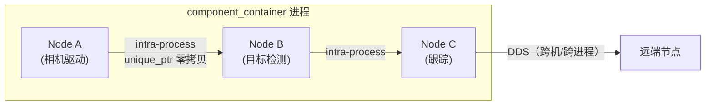

ROS2 的推荐架构因此是：**机器内高带宽链用容器+IPC，机器间/跨进程用 DDS**。

<a id="comp-lifecycle"></a>

## 2.6 生命周期节点（Lifecycle Node）

受管理节点把"初始化/配置/启动"变成显式状态机，让编排者可按序启动（驱动先于算法等）：

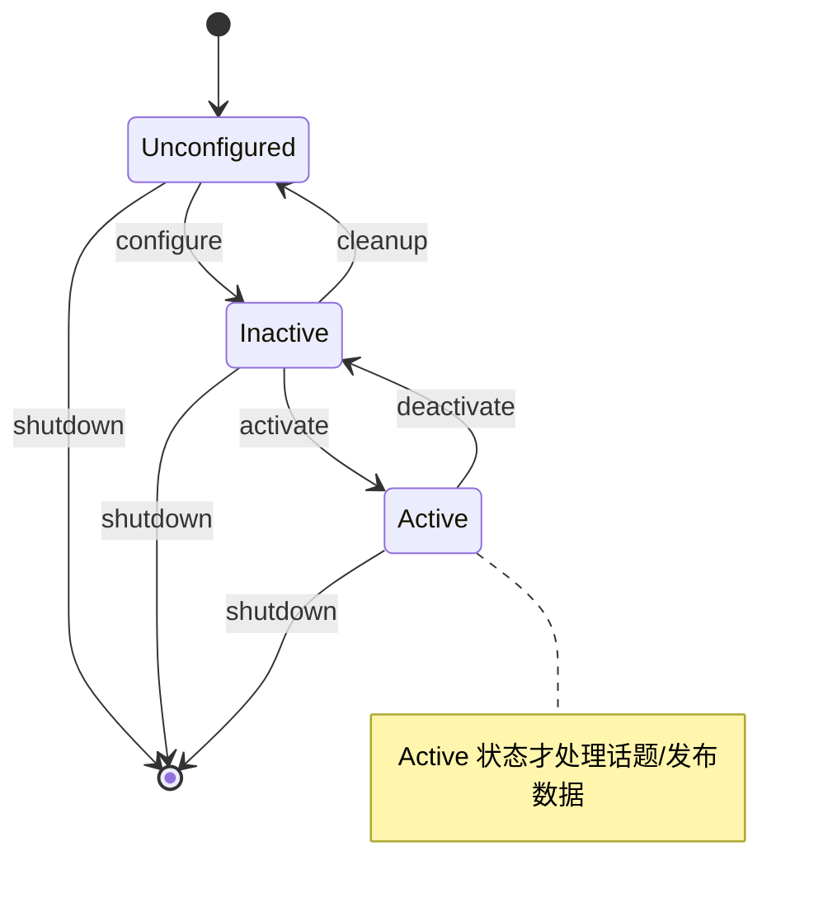

- 状态转换全部是**标准 service 调用**（`change_state`），外部编排器（launch 的 LifecycleEventHandler、运行管理器）可自动按依赖顺序拉起全系统；
- 适合：驱动、需要检查硬件再启动的节点。普通节点也可 `autoconfigured` 一键全自动。

<a id="comp-launch"></a>

## 2.7 Launch 系统

- ROS2 的 launch 是 **Python 库**（ros2launch），不再是 XML DSL：可以编程、传参、条件启动、处理事件。
- 三层抽象：**Action**（IncludeLaunchDescription、LaunchNode、RegisterEventHandler…）、**Substitution**（`$(find pkg)` 的 Python 版：FindPackageShare、EnvironmentVariable、LaunchConfiguration）、**事件**（process_started/exited → 联动重启）。
- 典型用法：节点描述化 + `launch_arguments` 传参 + `IfCondition(LaunchConfiguration('use_sim'))` 分支仿真/实车。

```python
def generate_launch_description():
    return LaunchDescription([
        DeclareLaunchArgument('use_sim', default_value='false'),
        Node(package='demo', executable='talker',
             parameters=[{'use_sim_time': LaunchConfiguration('use_sim')}],
             condition=IfCondition(LaunchConfiguration('use_sim'))),
        RegisterEventHandler(ProcessExited(event_handler=...))  # 崩溃自动重启等编排
    ])
```

---

<a id="net"></a>

# 3. 网络模型 ★

一句话总纲：**ROS2 网络模型 = DDS 的 P2P 去中心化模型**——没有 master，每个节点是一个 DDS Participant，靠**组播自动发现**对齐彼此，再按 QoS 语义点对点传数据。一切理解都从这里出发。

<a id="net-discovery"></a>

## 3.1 无中心发现机制（SPDP/SEDP）★

两个节点从"互不相识"到"能传数据"，走 DDS 标准 RTPS 协议的**两阶段发现**：

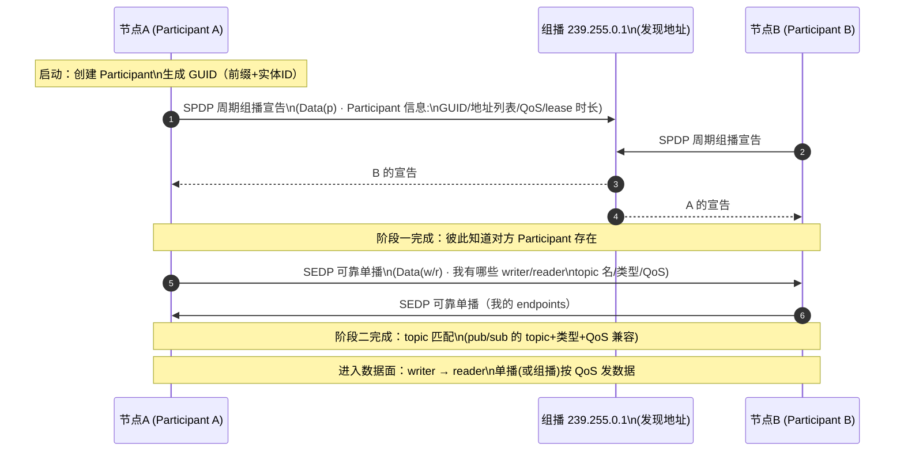

- **SPDP**（Simple Presence Discovery Protocol）：participant 级"我在这里"。**周期性组播**（默认几秒一次 + 随机抖动）到发现组播地址，内容含自身 GUID、所有可用地址、lease duration（超时未刷新即认为死亡）。
- **SEDP**（Simple Endpoint Discovery Protocol）：endpoint 级"我有什么"。**可靠单播**给已知 participant，交换 writer/reader 列表（topic 名、类型、QoS、可靠性设置）。
- **匹配规则**：topic 名相同 + 类型兼容 + QoS 兼容（见 §3.5 匹配矩阵）→ 双方建立 writer↔reader 对。
- **节点消亡**：lease 超时或收到优雅退出的 dispose → 反向摘除 endpoints。
- **实现差异**：Fast DDS/CycloneDDS 都按此协议，但发现参数（周期、单播/组播混合、初始 peer 列表）配置方式不同；**Zenoh 模型完全不同**（基于路由器/中心化 peer，见 §3.7）。

**发现流量画像**（排障关键）：节点刚启动时是发现风暴期——每节点周期组播 + 全量 SEDP 交换；**节点数 × topic 数 的平方级元数据**在大规模系统里会撑爆网络与 CPU（见 §5 不足）。

<a id="net-ports"></a>

## 3.2 RTPS 端口模型与 Domain

DDS 用**公式化端口**而非随机端口，便于防火墙/预测：

```text
port = PB + DG × domainId + PG × participantId + offset
  PB  = 7400  (port base)
  DG  = 250   (domain gain, 每个 domain 一段)
  PG  = 2     (participant gain, 同域内每个 participant 前进 2 个端口)
  offset（用途）:
    0  = SPDP 发现组播（well-known）
    10 = SEDP/元流量单播（metatraffic unicast）
    1  = 用户数据组播（user multicast）
    11 = 用户数据单播（user unicast）
```

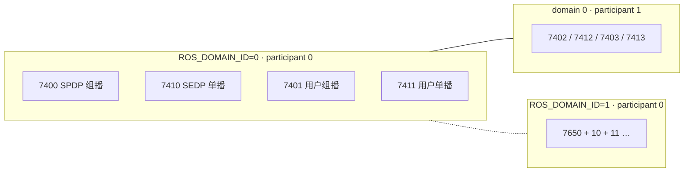

- **ROS_DOMAIN_ID**：DDS domain 隔离——不同 ID 的网络完全隔离（默认 0；REP 2000 规定合法范围 **0~101**，避免端口越过系统上限）。**同一物理网络跑多套机器人 = 换 domain**，这是最常用的"无线隔离"手段。
- participantId 冲突：同域内 participant 启动序号 0..120，耗尽会起不来（大规模+多进程节点时会遇到，Fast DDS 可配固定 participant id）。
- **组播地址**：默认发现组播走 `239.255.0.1`（各实现略有差异）；数据面默认**单播**（多订阅者各自一份，由 DDS 决定是否组播优化）。
- 防火墙放行清单：UDP 7400..7411+（domain 0, 两三个 participant 就是 7400~7413 级别）+ 组播 239.255.0.1。**丢组播 = 发现失败**（云端/VPN 默认丢组播 → §3.7）。

<a id="net-dataplane"></a>

## 3.3 数据面：可靠/尽力传输、组播与分片

匹配完成后，数据按 QoS 走两条路：

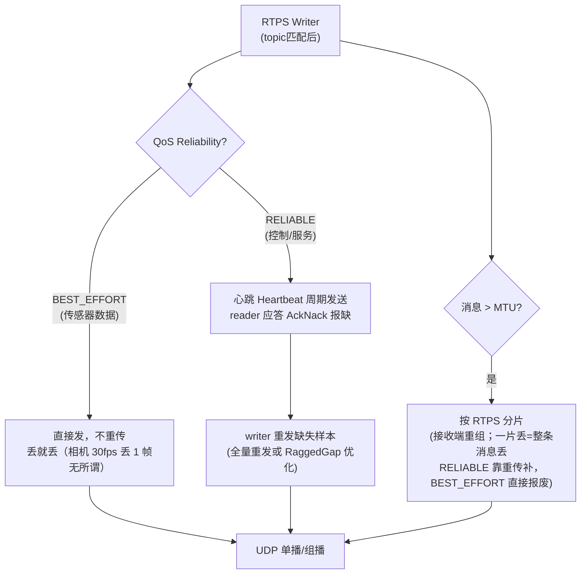

- **BEST_EFFORT + KEEP_LAST(depth=N)** 是传感器流标配：新样本挤掉旧样本，永不阻塞发送端——**背压由"丢历史"承担**。
- **RELIABLE** 由 DDS 心跳/应答机制保证最终送达（这是 DDS 自带的重传，与 §9 的应用层 NACK 无关）。
- **大消息**（1MB 点云）：CDR 序列化后按 MTU（~1.4KB）分片；BEST_EFFORT 下丢一片整条消息作废——所以图像话题必须 RELIABLE 或减小消息/开压缩（CompressedImage）。
- **流量控制**：Fast DDS 支持发送流量控制器（按字节配额），CycloneDDS 有 max message size——防大消息挤爆链路。

<a id="net-svc"></a>

## 3.4 service / action 在网络层的真实形态

DDS 标准本身没有 service 概念（DDS 只有 topic pub/sub），所以 **service 是 ROS 层用 DDS 拼出来的**，且各 RMW 实现方式不同：

- **Fast DDS**：为每个 service 建一对专用 topic（request/response 方向各一个），请求消息头部带 16 字节关联头（GUID+sequence）做请求↔应答关联；Humble 后引入 service event 主题处理中断请求。
- **CycloneDDS**：按 DDS-RPC 风格，reader/writer 带 tagging（userData 里写 service 与角色），response 与 request 经 cookie 关联。
- **共同行为**：client 发请求后**等 response**，有超时（`client.wait_for_service` / call 的 timeout）；服务端处理在**服务端 executor 线程**里执行（回调组约束）。
- **面试口径**："service = 两个 topic + 关联协议；action = goal/result 用 service、feedback/status 用 topic、status 是周期广播的状态机"。

Action 的网络形态展开：

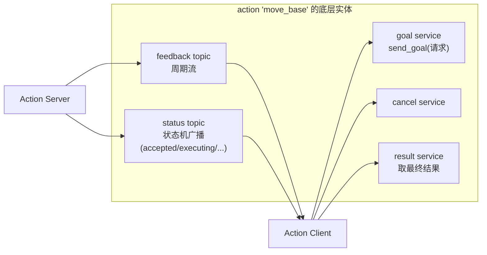

=> **action 不是新的网络机制**，是模式约定；这也解释了为什么 action 的取消/状态查询天然可用 ros2cli 观测。

<a id="net-qos"></a>

## 3.5 QoS 全解析与匹配规则 ★

QoS（Quality of Service）是 ROS2 对 ROS1 最大的行为升级——**同一 topic 双方 QoS 不兼容时静默不通**（默认只打印一次警告），是新手第一大坑。

**核心 QoS 策略**：

| 策略 | 取值 | 含义 | 典型选择 |
|---|---|---|---|
| **Reliability** | RELIABLE / BEST_EFFORT | DDS 心跳重传 vs 尽力而为 | 控制指令/服务 RELIABLE；相机/激光 BEST_EFFORT |
| **History** | KEEP_LAST(depth) / KEEP_ALL | 每个 reader/writer 缓存 N 个最新样本 / 全存 | 传感器 KEEP_LAST(1~5) |
| **Durability** | VOLATILE / TRANSIENT_LOCAL | 订阅晚加入收不到历史 / **能收到发布端缓存的历史** | 地图/tf 静态/参数类 TRANSIENT_LOCAL |
| **Deadline** | 时长 | 两次样本间隔上限，超时触发 deadline 事件 | 监控超频/断流 |
| **Lifespan** | 时长 | 样本过期自动丢弃 | 防止旧指令被执行 |
| **Liveliness** | AUTOMATIC / MANUAL_BY_TOPIC | writer 存活检测方式 | 断连检测 |
| **Ownership** | SHARED / EXCLUSIVE | 多 publisher 竞争时（EXCLUSIVE 按 ownership strength 选主） | 冗余控制器热备 |
| **LatencyBudget** | 时长 | 提示 DDS 可容忍的处理延迟 | 微调 |

**兼容性矩阵（必须背）**——只对"请求型"策略有方向要求：**发布端提供 ≥ 订阅端要求**才能匹配：

| pub ↓ / sub → | BEST_EFFORT | RELIABLE |
|---|---|---|
| **BEST_EFFORT** | ✅ 匹配 | ❌ **不匹配（不通！）** |
| **RELIABLE** | ✅ 匹配（sub 降级为尽力） | ✅ 匹配 |

| pub ↓ / sub → | VOLATILE | TRANSIENT_LOCAL |
|---|---|---|
| **VOLATILE** | ✅ | ❌ **不匹配** |
| **TRANSIENT_LOCAL** | ✅（晚加入者不收历史） | ✅（晚加入者收历史） |

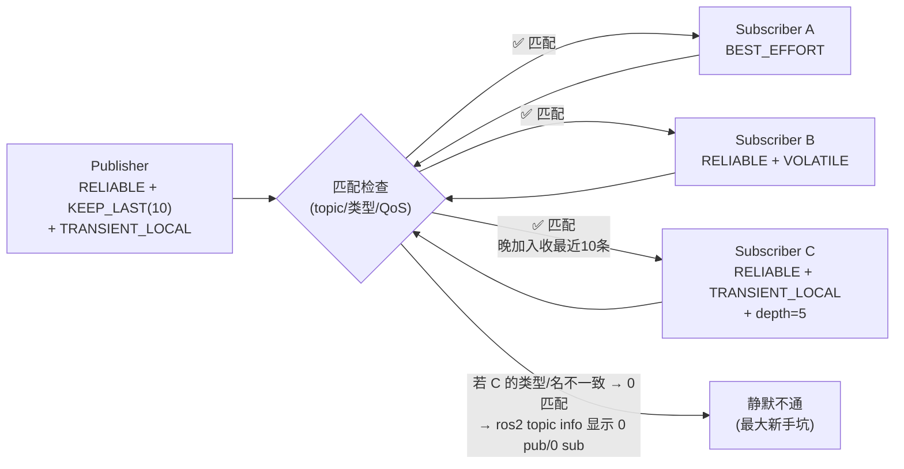

排障口诀：**"发布订阅都在但收不到"——先 `ros2 topic info -v` 看双方 QoS，再看 domain 与组播**。

默认 QoS（rclcpp 的 QoS(depth)）：RELIABLE + VOLATILE + KEEP_LAST(depth)；`rclcpp::SensorDataQoS()` = BEST_EFFORT + KEEP_LAST(5)；`rclcpp::SystemDefaultsQoS()` 由 RMW 配置决定。

<a id="net-shm"></a>

## 3.6 共享内存与零拷贝

大消息（点云 1MB+）的传输链路成本：**序列化 → 分片 → 内核 UDP 拷贝 ×2 → 重组 → 反序列化**。三条优化路径：

| 方案 | 层级 | 机制 | 条件 |
|---|---|---|---|
| **DDS 共享内存（SHM）** | RMW 内部 | 同机 participant 间走共享内存 ring buffer（Fast DDS 默认开；可回退 UDP） | 同机 |
| **ROS2 进程内 IPC** | rclcpp 层 | 同进程容器内 `unique_ptr` 发布 → **指针移交，零序列化零拷贝**（§2.5） | 同进程 + QoS 兼容 |
| **iceoryx** | 独立中间件 | position-on-shard 的真零拷贝总线（可挂 rmw） | 高频大消息专用 |

Fast DDS 零拷贝（loaned message）：`publish(std::move(unique_ptr))` + SHM 时数据**完全不经过网络栈**，延迟从 ms 级降到 µs 级。注意：**多机通信永远走网络**，SHM 只救同机。

<a id="net-wan"></a>

## 3.7 跨网段 / 云 / VPN 组网（Discovery Server / Zenoh）

组播（239.255.0.1）**不可跨路由**，所以跨网段/VPN/云环境发现会直接失败。三种官方路径：

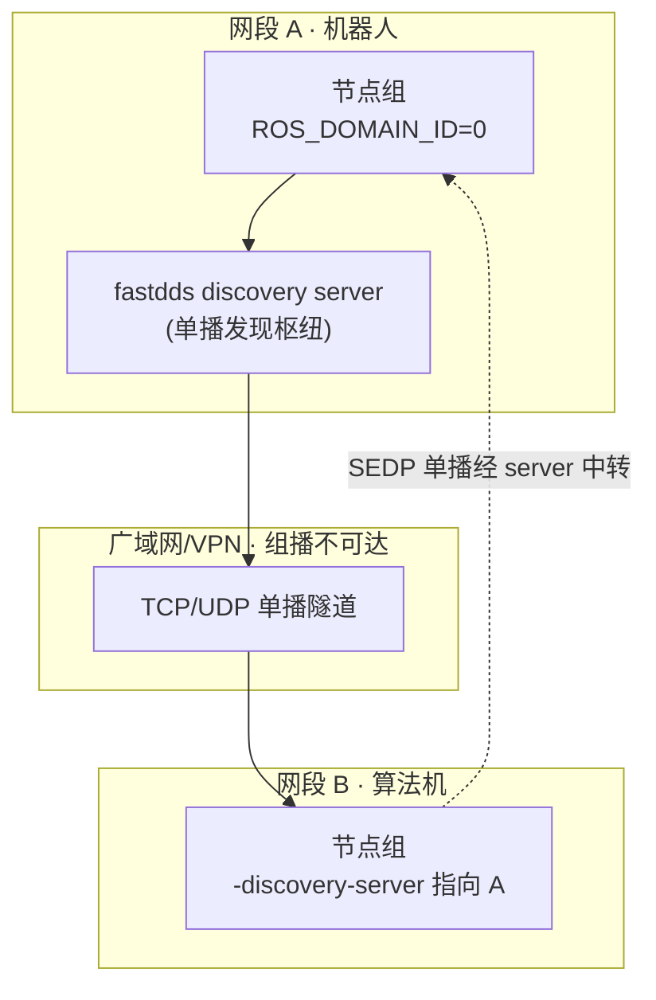

1. **Discovery Server**（Fast DDS 独有）：把 SPDP 组播替换为**单播到中心 server**——server 只做"发现中介"，数据仍点对点。`fastdds discovery -i 0 -l ip`，客户端 `-discovery-server://ip:port`。
2. **CycloneDDS peer 列表**：`CYCLONEDDS_URI` 配 `<Peers>` 固定单播 peer（小规模可手配，大规模难维护）。
3. **rmw_zenoh（Kilted 2025 起默认）**：换掉"组播发现"范式，用 **Zenoh 路由器（zenohd）**做可路由的发现+数据中继，天然适配 WAN/云/弱网，且 discovery 流量 O(N) 而非 O(N²)——**这是官方对 DDS 组网缺陷的正面回应**。
4. 补充手段：ROS_DOMAIN_ID 隔离多机编队；`ROS_LOCALHOST_ONLY=1` 单机调试（禁外发组播）；WireGuard/SDVPN 打隧道后仍需单播发现。

<a id="net-ros1"></a>

## 3.8 ROS1 vs ROS2 网络模型对比

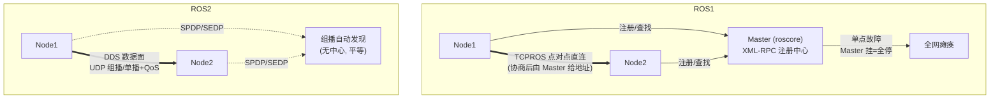

| 维度 | ROS1 | ROS2 |
|---|---|---|
| 发现 | Master 注册（中心化） | DDS 组播自动发现（去中心） |
| 传输 | TCPROS（TCP）/UDPROS | RTPS over UDP（TCP 可选） |
| QoS | 无（只有 TCP 缓冲） | 完整 QoS 体系 |
| 实时性 | 不支持 | 可支持（PREEMPT_RT + executor 调优） |
| 故障 | Master 单点 | 无单点（但发现风暴是新问题） |
| 序列化 | 自有 md5sum | CDR 标准（DDS IDL） |
| 跨语言 | C++/Python 为主 | 任意有 rmw 绑定的语言 |

---

<a id="cli"></a>

# 4. 常用命令

<a id="cli-build"></a>

## 4.1 工作空间与构建

```bash
# —— 环境搭建 ——
source /opt/ros/humble/setup.bash          # 加载发行版 underlay
mkdir -p ~/ros2_ws/src && cd ~/ros2_ws/src
ros2 pkg create my_pkg --build-type ament_cmake \
  --dependencies rclcpp std_msgs           # 生成包骨架

# —— 构建与安装 ——
cd ~/ros2_ws
colcon build                                # 全量构建
colcon build --packages-select my_pkg       # 只构建某包
colcon build --symlink-install              # 符号链接：改 launch/配置免重编
colcon build --cmake-args -DCMAKE_BUILD_TYPE=Release
colcon build --parallel-workers 8           # 限制并行（低内存机器）
colcon test --packages-select my_pkg && colcon test-result --verbose
source install/setup.bash                   # overlay 生效

# —— 依赖 ——
rosdep install --from-paths src --ignore-src -r -y   # 按 package.xml 装系统依赖
ros2 pkg list | grep my_pkg
ros2 pkg executables my_pkg                 # 该包可运行的可执行文件
```

<a id="cli-cmd"></a>

## 4.2 ros2 CLI 全家福

```bash
# —— 节点 ——
ros2 node list                    # 图内节点
ros2 node info /talker            # 某节点的 pub/sub/srv/action/param 详情

# —— 话题 ——
ros2 topic list [-t]              # 列表（-t 带类型）
ros2 topic info /chatter -v       # ★ 发布/订阅数 + 双方 QoS（排障第一命令）
ros2 topic echo /chatter          # 打印消息
ros2 topic pub /chatter std_msgs/msg/String "{data: hello}" -r 10
ros2 topic hz /chatter            # 实际频率
ros2 topic bw /chatter            # 带宽占用
ros2 topic find sensor_msgs/msg/Image   # 按类型找话题
ros2 topic delay /tf              # 消息延迟（需要 message_info）

# —— 服务 ——
ros2 service list -t
ros2 service type /add_two_ints
ros2 service call /add_two_ints example_interfaces/srv/AddTwoInts "{a: 1, b: 2}"

# —— 动作 ——
ros2 action list -t
ros2 action send_goal /move_base nav_msgs/behavior... "{...}" --feedback

# —— 参数 ——
ros2 param list /node
ros2 param get /node gain
ros2 param set /node gain 2.5
ros2 param dump /node > node.yaml          # 导出；--load 导入

# —— 接口（消息/服务/动作定义） ——
ros2 interface show sensor_msgs/msg/Image
ros2 interface package sensor_msgs

# —— 录制回放（rosbag2） ——
ros2 bag record /chatter /camera/image     # 录制指定话题
ros2 bag record -a -o my_bag               # 全录到 my_bag
ros2 bag info my_bag
ros2 bag play my_bag --rate 2.0 --topics /chatter

# —— 生命周期 ——
ros2 lifecycle get /lc_node
ros2 lifecycle set /lc_node configure      # unconfigured→inactive
ros2 lifecycle set /lc_node activate

# —— 系统诊断 ——
ros2 doctor --report       # 环境体检（domain/rmw/网络/版本）
ros2 daemon stop           # ros2cli 后台守护（卡住时先停它）
ros2 wtf                   # = ros2 doctor

# —— 多机/多域调试 ——
ros2 multicast receive     # 监听组播（验证组播可达性）
ros2 multicast send        # 发组播测试包（两台机器互测！）
```

`ros2 topic info -v` 输出示例（QoS 不匹配排障）：

```text
Type: std_msgs/msg/String
Publisher count: 1
Subscription count: 1
Node name: talker
Node namespace: /
Topic type: std_msgs/msg/String
QoS profile:
  Reliability: RELIABLE
  Durability: VOLATILE
  History: KEEP_LAST
  Depth: 10
```

<a id="cli-env"></a>

## 4.3 关键环境变量

| 变量 | 作用 | 示例 |
|---|---|---|
| `ROS_DOMAIN_ID` | DDS 域隔离（0~101），**多机器人共网必备** | `export ROS_DOMAIN_ID=42` |
| `RMW_IMPLEMENTATION` | 切换 DDS 实现 | `rmw_fastrtps_cpp` / `rmw_cyclonedds_cpp` / `rmw_zenoh_cpp` |
| `ROS_LOCALHOST_ONLY` | 只允许本机通信（禁外发组播） | `=1`（单机调试/演示） |
| `CYCLONEDDS_URI` | CycloneDDS 配置文件（peer/网卡/SHM） | `file:///path/cyclonedds.xml` |
| `FASTRTPS_DEFAULT_PROFILES_FILE` | Fast DDS XML 配置 | 同上 |
| `ROS_LOG_DIR` | 日志目录 | `~/.ros/log` |
| `RCUTILS_COLORIZED_OUTPUT` | 彩色日志开关 | `=0` |
| `ROS_TIME_SOURCE` / `use_sim_time` | 仿真时钟 | 参数级设置更常用 |
| `AMENT_PREFIX_PATH` | overlay 叠加（source setup.bash 自动维护） | — |
| `COLCON_*` | colcon 行为（如 `COLCON_DEFAULTS_FILE`） | — |

---

<a id="issues"></a>

# 5. 当前不足 ★

按"实际部署会撞到什么"排序，每条给出机理与现行缓解手段：

## 5.1 发现机制的可扩展性天花板

- **机理**：SPDP 周期组播 + SEDP 全量端点交换，元数据规模 ≈ O(节点² × 话题数)。百节点级（如 100 台机器 × 每台 20 节点）时，组播风暴 + 端点库内存 + CPU 全部进入危险区；组播 TTL、IGMP snooping 配置不当还会扩散到无关网段。
- **缓解**：Discovery Server（单播化发现）、减少跨机话题（局部性设计）、Zenoh（O(N) 发现）、小 domain 切分。
- **现状定性**：单机器人/小集群成熟，**大规模分布式仍是 ROS2 最被诟病的短板**。

## 5.2 跨网段/云/VPN 组网靠外部手段

- 组播不可路由是网络常识，但 ROS2 的默认发现完全依赖它——跨网段必须上 Discovery Server / Cyclone peer 列表 / Zenoh router（§3.7），**官方默认配置开箱即用的范围只有"同一 L2 广播域"**。
- 云端编排（K8s/多区域）没有一等公民支持；NAT 穿越无内建（对比 WebRTC 的 ICE）。

## 5.3 QoS 不兼容静默失效

- 语义上合理（DDS 标准行为），工程上致命：**发布/订阅都活着、却收不到任何数据**，只在某端打印一次警告。
- 团队规范缺失时，service/topic/传感器混用 QoS 的系统极难排查（`ros2 topic info -v` 是唯一武器）。
- 缓解：约定传感器 QoS 常量、CI 阶段用 rosbag 回放校验。

## 5.4 RMW 实现碎片化

- 三/四家实现的服务调用、QoS 边角、SHM、参数边界行为存在**实现差异**；同机混装两种 RMW 的节点互操作在服务/动作上历史坑多。
- API 级差异：`rmw_*_cpp` 生成代码与实现耦合，跨实现编译产物不通用。
- 缓解：全系统锁定单一 RMW（CI 里显式 `RMW_IMPLEMENTATION`）；Kilted 起官方押注 Zenoh 值得跟进，但意味着又一次迁移成本。

## 5.5 大消息链路成本与"零拷贝幻觉"

- 默认路径：序列化 → 分片 → 内核拷贝 → 重组 → 反序列化，图像/点云话题 CPU 消耗显著。
- 进程内零拷贝（§2.5）条件苛刻（同进程、unique_ptr、QoS 匹配、分配器一致），SHM 各实现能力参差；**多机之间没有任何零拷贝**——所以"点云传到另一台机器"永远是带宽大户（CompressedImage/Draco 点云压缩是常规解）。

## 5.6 安全体系部署成本高

- DDS Security（SROS2）标准存在但配置繁琐：证书/签名/访问策略 XML，节点多时策略文件管理负担大；多数生产部署仍在裸奔（明文 UDP），靠网络隔离兜底。
- 相比之下 ROS1 时代同样没有——属于"欠账"而非退步。

## 5.7 实时性与确定性依赖调优

- 框架本身可实时（executor/定时器/内存分配可控），但默认配置不实时：回调分配内存、日志 IO、DDS 内部线程优先级都需要显式调（`SCHED_FIFO`、预分配、Fast DDS 线程配置）。
- executor 模型下回调串行化的隐式延迟（§2.3）容易造成"定时器漂移"，需要 callback group 拆分才能达标。

## 5.8 其他工程性短板

- **调试困难**：分布式无中心 + 事件驱动，异常时序问题（QoS 丢历史、executor 阻塞、发现失败）比 ROS1 更隐蔽；`ros2 doctor`/rosbag2 回放是主要手段，但缺可视化全链路追踪（tracing 需 ros2_tracing + perf/Perfetto 自搭）。
- **Windows/嵌入式支持次级**：官方主力在 Ubuntu；Windows 可用但生态（驱动/仿真）差距大；MCU 级支持（micro-ROS）架构独立。
- **生态迁移债**：大量 ROS1 包未迁移/质量参差；接口与参数 API 在版本间演进（Humble→Jazzy 的弃用项），ABI 不稳定——升级发行版有工作量。
- **时间同步无内建**：分布式时间戳对齐靠 NTP/PTP 外部建设，`use_sim_time` 只解决仿真场景。
- **rosbag2 与数据治理**：录制格式（mcap/sqlite）演进、大文件切分、云端索引等仍简陋。

---

## 结语

- **架构记忆锚点**：ROS2 = rclcpp/rclpy → rcl → rmw → DDS(RTPS)；构建=ament+colcon；编排=Launch；调试=ros2cli。
- **网络模型记忆锚点**：无 master；SPDP 组播宣告 → SEDP 单播对齐端点 → QoS 匹配 → 数据面 UDP（RELIABLE 心跳重传 / BEST_EFFORT 丢旧保新）；端口=7400+250×domain+2×pid+offset；组播不出网段。
- **上手排障三板斧**：`ros2 doctor`（环境）→ `ros2 topic info -v`（QoS）→ `ros2 multicast send/receive`（组播连通性）。
- **趋势判断**：发现机制的 O(N²) 与组播依赖是结构性短板，官方路线（Zenoh 作为默认 RMW）就是在换掉这一层——评估新项目时值得把 rmw_zenoh 纳入候选。

