# WebRTC 全链路详解

> 覆盖：本地初始化 → SDP 协商 → ICE 采集/探测/建连/排序 → 信令每一步的意义 → 发送管道（Pacer）→ BWE（TWCC/GCC/Probe）→ Simulcast/SVC → NACK(RTX)/FEC → JitterBuffer/NetEQ。
> 图均为 Mermaid，VS Code（装 Mermaid 插件）/GitHub/Typora 可直接渲染。
> 术语以 libwebrtc/mediasoup 实现为准，与你的 mediasoup 客户端项目可直接对照。

---

## 目录

- [1. 全景架构与端到端大时序](#overview)
- [2. 初始化：PeerConnection 与媒体引擎](#init)
- [3. SDP 协商（JSEP Offer/Answer）](#sdp)
  - [3.1 协商时序](#sdp-flow)
  - [3.2 SDP 关键属性解剖](#sdp-anatomy)
  - [3.3 Renegotiation 与 Trickle ICE](#sdp-reneg)
- [4. ICE 全流程 ★](#ice)
  - [4.1 候选采集 Gather](#ice-gather)
  - [4.2 候选配对与优先级排序](#ice-pairing)
  - [4.3 连通性检查（探测）与提名](#ice-check)
  - [4.4 ICE 状态机与 Consent 保活](#ice-state)
  - [4.5 ICE Restart](#ice-restart)
  - [4.6 NAT 穿透能力矩阵](#ice-nat)
- [5. DTLS 握手与 SRTP 密钥](#dtls)
- [6. 发送侧媒体管道与 Pacer](#tx)
  - [6.1 管道流水线](#tx-pipeline)
  - [6.2 RTP / RTCP 基础](#tx-rtp)
  - [6.3 Pacer 平滑器](#tx-pacer)
- [7. 带宽估计 BWE ★](#bwe)
  - [7.1 演进：REMB → Transport-CC](#bwe-evo)
  - [7.2 TWCC 反馈机制](#bwe-twcc)
  - [7.3 GCC 算法状态机](#bwe-gcc)
  - [7.4 带宽探测 Probe](#bwe-probe)
  - [7.5 码率分配与编码器联动](#bwe-alloc)
- [8. Simulcast 与 SVC ★](#simulcast)
- [9. 丢包恢复：NACK/RTX 与 FEC](#nack)
  - [9.1 NACK 与 RTX 重传流](#nack-rtx)
  - [9.2 FEC（FlexFEC/ULPFEC/RED/Opus-FEC）](#fec)
  - [9.3 NACK vs FEC 的分工](#nack-vs-fec)
- [10. 接收侧：JitterBuffer 与 NetEQ](#rx)
  - [10.1 视频：帧完整性等待与解码队列](#rx-video)
  - [10.2 抖动估计](#rx-jitter)
  - [10.3 音频 NetEQ（PLC/加速/减速）](#rx-neteq)
  - [10.4 端到端延迟分解](#rx-latency)
- [11. RTCP 报文全家福](#rtcp)
- [12. getStats 调试速查](#stats)

---

<a id="overview"></a>

# 1. 全景架构与端到端大时序

## 1.1 全景架构

WebRTC 的协议栈分层（自下而上）：

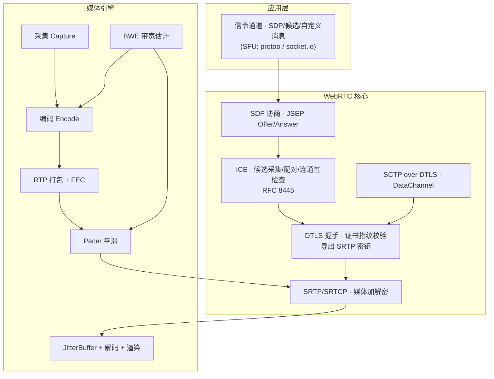

要点：
- **信令不在 WebRTC 标准内**——WebRTC 只规定"两端如何交换 SDP 与候选"，用什么通道传（WebSocket/HTTP/鸽子）无所谓。mediasoup 用 protoo（wss）。
- 媒体**不经过信令服务器**：P2P 时两端直连，SFU（mediasoup）时客户端只与 SFU 建连（SFU 转发，不做编解码）。
- ICE/DTLS/SRTP 是安全与连通的三层地基；BWE/Pacer/FEC/JitterBuffer 是体验层。

## 1.2 端到端大时序（从 new RTCPeerConnection 到看到画面）

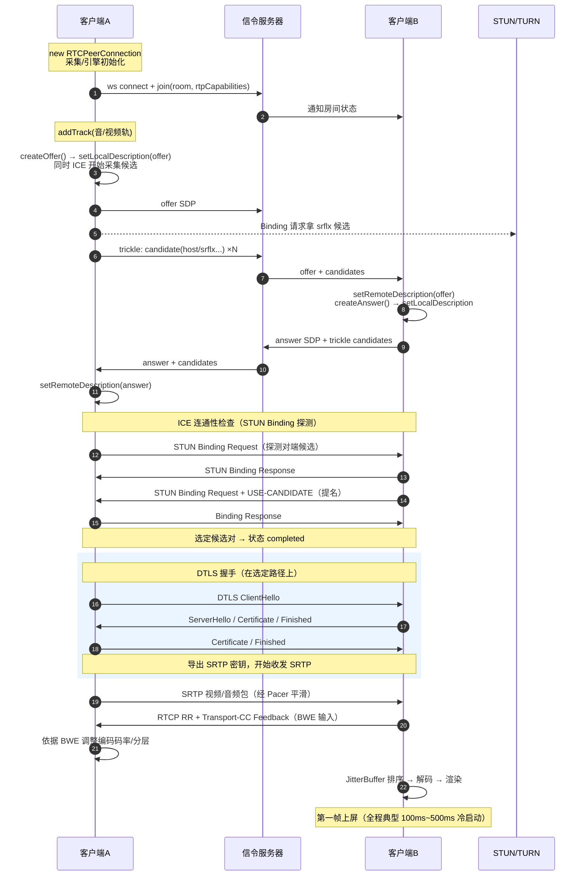

读图要点：
- **SDP 协商与 ICE 采集并行**：setLocalDescription 一调用，ICE 就开始采集，不必等对端——这就是 Trickle ICE 的由来。
- **每个协议各司其职**：信令=交名片；ICE=确认能通；DTLS=互验身份+发钥匙；SRTP=加密传话。

---

<a id="init"></a>

# 2. 初始化：PeerConnection 与媒体引擎

## 2.1 发生在哪一步

`new RTCPeerConnection(config)` 时（libwebrtc 内部）：

1. **网络线程**（network thread）启动：负责 socket/ICE/STUN；
2. **工作线程**（worker thread）启动：负责媒体处理流水线；
3. **媒体引擎**装配：编解码器工厂（H264/VP8/VP9/AV1/Opus 的编码器、解码器、硬件加速探测——libmediasoupclient 用 injectable 工厂，正是 mediasoup-client 原生客户端注入 MF/NVENC 工厂的位置）；
4. **ICE 上下文**创建：读 config 里的 `iceServers`（STUN/TURN 地址、凭据）、ICE 策略（all/relay）、bundle/rtcp-mux；
5. SdpSemantics 统一为 UnifiedPlan（B52007 后唯一支持）。

config 关键项：

```js
new RTCPeerConnection({
  iceServers: [
    { urls: 'stun:stun.l.google.com:19302' },
    { urls: 'turn:host:3478?transport=udp',
      username: 'u', credential: 'p' },
  ],
  iceTransportPolicy: 'all',        // 'relay' 强制全走 TURN（抓包/强 NAT 调试）
  bundlePolicy: 'max-bundle',       // 所有 m-line 复用一条 ICE 传输（默认）
  rtcpMuxPolicy: 'require',
});
```

## 2.2 与 mediasoup 的对应关系

- mediasoup 服务端是 **ICE-Lite**（只响应不主动探测）、每 peer 两个 WebRtcTransport（send/recv）各一条 ICE 通道；
- 客户端 `device.load({routerRtpCapabilities})` 相当于确定编解码协商能力集；
- `transport.produce(...)` → 生成 SDP offer（仅该 track）→ 服务端 `transport.produce()` 建 mediasoup Producer → **服务端没有 SDP answer 的完整语义**：libmediasoupclient 在 OnConnect 里把 dtlsParameters 发给服务端 `connectWebRtcTransport`，握手参数直接交换——比标准 JSEP 少一次往返，这就是 mediasoup 协议里 transports 必须先于 join 的原因。

---

<a id="sdp"></a>

# 3. SDP 协商（JSEP Offer/Answer）

<a id="sdp-flow"></a>

## 3.1 协商时序

JSEP = JavaScript Session Establishment Protocol。核心是 **Offer/Answer 状态机**：

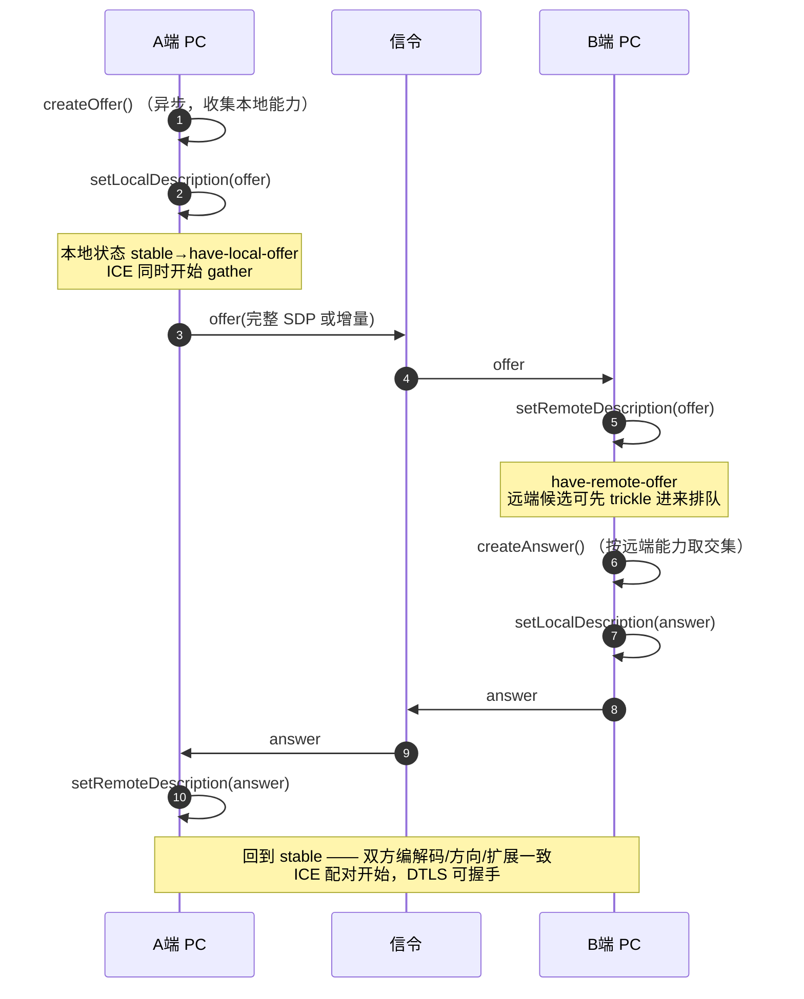

- Offer 是"我会什么"（能力全集），Answer 是"我们俩用哪个"（**交集决策**，决定 payload type 编号——**编码器/解码器都以 answer 里的 PT 为准**）。
- SDP 一旦 set，媒体管道按它搭建：payload type、SSRC、扩展 ID 全部绑定。

<a id="sdp-anatomy"></a>

## 3.2 SDP 关键属性解剖

一份视频 m-line 逐行含义：

```text
m=video 9 UDP/TLS/RTP/SAVPF 96 97 103      ; 媒体类型/占位端口/传输/支持的 PT 列表
c=IN IP4 0.0.0.0                            ; 旧字段，端口实际由 ICE 候选决定
a=mid:0                                     ★ 流标识，与 transport/rtx 绑定用
a=sendrecv                                  ; 方向：send/sendonly/recvonly/inactive
a=rtcp-mux                                  ; RTP 与 RTCP 同端口复用
a=setup:actpass                             ; DTLS 角色：我可 actpass（对端选 active/client）
a=fingerprint:sha-256 AB:CD:...             ★ DTLS 证书指纹——握手时验身份防中间人
a=ice-ufrag:abcd  a=ice-pwd:xxxx            ; ICE 凭据（放在 SDP 里随信令传）
a=rtpmap:96 H264/90000                      ; PT=96 是 H264，时钟 90kHz
a=fmtp:96 profile-level-id=42e01f;packetization-mode=1   ; 编码参数（档次/分包模式）
a=rtcp-fb:96 nack                           ; 支持 NACK 重传
a=rtcp-fb:96 nack pli                       ; 支持 PLI（关键帧请求）
a=rtcp-fb:96 ccm fir                        ; FIR 关键帧请求（另一形式）
a=rtcp-fb:96 goog-remb                      ; 接收端 BWE：REMB 反馈
a=rtcp-fb:96 transport-cc                   ; 接收端 BWE：TWCC 反馈（新）
a=rtx:97 apt=96                             ; PT=97 是 96 的重传流（RTX）
a=extmap:4 urn:ietf:params:rtp-hdrext/...abs-send-time    ; RTP 头扩展（发送时间戳）
a=extmap:18 transport-wide-cc-originator?   ; TWCC 序列号扩展（每包一个传输层序号）
a=simulcast:send h;med;lo                   ; simulcast 声明（见 §8）
a=rid:h send                                 ; RID 与 simulcast 配套
a=ssrc:1111 cname:xxx                       ; SSRC 与 CNAME（RTCP 身份）
a=ssrc-group:FID 1111 2222                  ; FID：2222 是 1111 的 RTX 流
```

★ 的三行是面试必问：**mid**（bundle 后多路流复用一条 ICE，靠 mid 分流）、**fingerprint**（DTLS 证书绑定，防 MITM）、**ufrag/pwd**（ICE 认证）。

音视频方向的联动：`addTrack` → sendrecv/sendonly；`track.enabled=false` 只停发不协商；真正改方向要 renegotiation。

<a id="sdp-reneg"></a>

## 3.3 Renegotiation 与 Trickle ICE

**Renegotiation**：媒体拓扑变化（加/删 track、改方向、simulcast 层变化）→ 需要新一轮 offer/answer。触发方：
- 本端 `addTrack/removeTrack/setParameters` 后调 `createOffer`；
- 对端新流到达触发 `onnegotiationneeded`（发送方向）。

mediasoup 特例：**服务端发起的 consumer 不走 SDP renegotiation**——服务端直接给客户端发 `newConsumer` protoo 请求，客户端 `transport.consume()` 用请求里的 rtpParameters 直接建接收管道（libmediasoupclient 支持这种"无 SDP"路径），所以 mediasoup 的下行扩容非常快。

**Trickle ICE**：候选不随 SDP 一次性传，而是**采到一个发一个**（`onicecandidate` → 信令 → 对端 `addIceCandidate`）。优势：省一个 ICE 采集等待周期（host/srflx/relay 各有超时），首帧延迟可减数百毫秒。对端在 setRemoteDescription 前收到的候选先缓存，之后回放。

---

<a id="ice"></a>

# 4. ICE 全流程 ★

ICE（Interactive Connectivity Establishment，RFC 8445）解决一个问题：**两个隔着 NAT 的端点，如何找到一条能互相到达的 UDP 路径**。四步：采集候选 → 交换候选 → 配对排序 → 探测提名。

<a id="ice-gather"></a>

## 4.1 候选采集 Gather

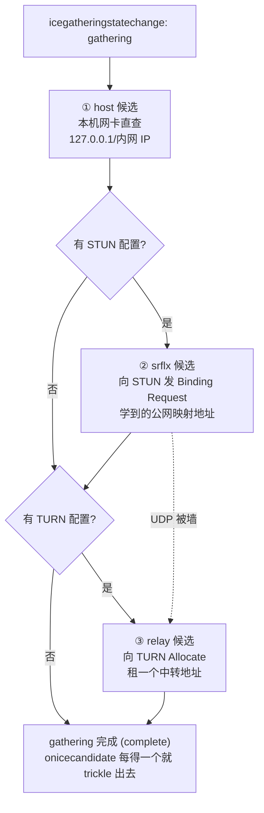

- **host**：本机所有网卡的 IP（含 127.0.0.1、内网 192.168.x）。同网段直连最快。
- **srflx**（server-reflexive）：对 STUN 服务器发一个 Binding Request，服务器回包里带"我看到你的公网 IP:端口"——这就是 NAT 在外网看到的映射地址。**这一步同时探测了 NAT 类型**（后面讲）。
- **relay**：向 TURN 服务器 Allocate 一个中转端口，所有媒体经 TURN 转发。**最贵但最通**：对称 NAT/企业防火墙下唯一出路。
- **prflx**（peer-reflexive）：探测过程中"意外"学到的对端地址（非交换过的候选），可临时建对，优先级低于 srflx。
- 采集顺序 host → srflx → relay（并行发起，完成有先后）；默认会**等待候选采集完成才 resolve createOffer 的 setLocalDescription promise**（可配 iceCandidatePoolSize 预热）。

**NAT 类型判定原理**（STUN RFC 3489 老法子，现代 ICE 只关心"能不能通"）：从同一内网 socket 向 STUN 的两个不同 IP:Port 发请求，比较映射地址——**一致 → Cone 型**（srflx 可直接用）；**不一致 → 对称 NAT**（srflx 没用，必须 TURN）。Windows/家宽多为 Endpoint-Independent/Address-Dependent Mapping，手机蜂窝网常见对称。

<a id="ice-pairing"></a>

## 4.2 候选配对与优先级排序

双方交换候选后，做**笛卡尔积配对**（同 component、同传输协议、IP 不重复），然后按公式给每对打分排序：

```text
pair priority = 2^24 × min(type_pref) + 2^8 × min(local_pref) + 256 − component_id
type_pref:    host=126  prflx=110  srflx=100  relay=0
local_pref:   各候选在本端的偏好（多网卡区分，ipv6 通常更高）
component_id: RTP=1（rtcp-mux 后只有 1）
```

含义：**host>srflx>relay**——能直连绝不中转。排序后形成 **checklist**（检查清单），按优先级从高到低依次探测，高优先级探测成功即 nomination，低优先级对进入 frozen（冻结）。

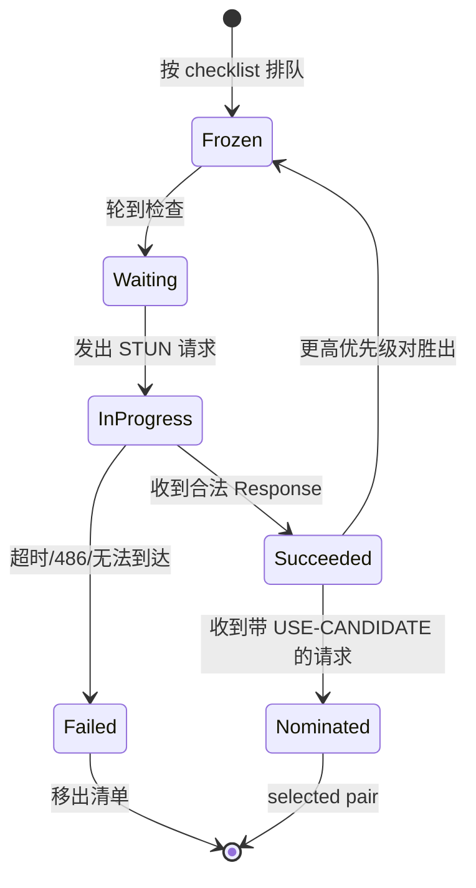

mediasoup 服务端是 **ICE-Lite**：不建 checklist、不主动探测，只应答客户端的探测请求；**客户端永远是 controlling 角色**（做提名的一方）。

<a id="ice-check"></a>

## 4.3 连通性检查（探测）与提名

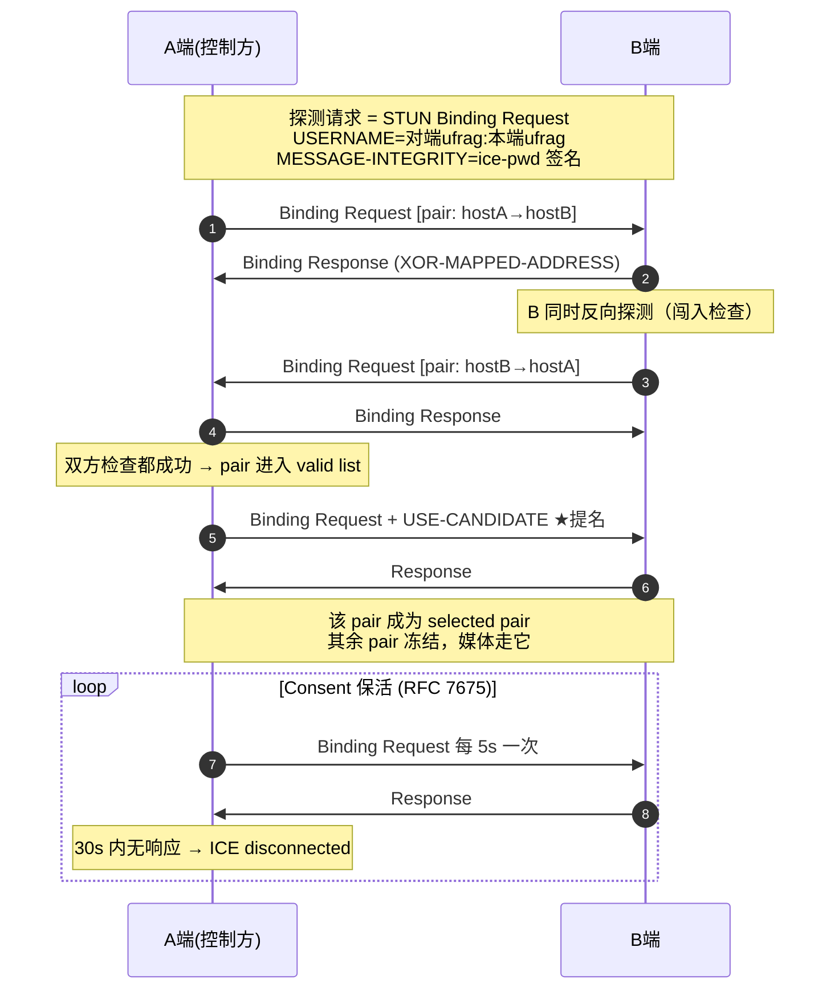

细节：
- **探测请求即认证**：USERNAME 必须含对端 ufrag（地址过滤），MESSAGE-INTEGRITY 用对端 ice-pwd 的 HMAC 签名（防伪造探测）。
- **响应里的 XOR-MAPPED-ADDRESS 若与请求源不符** → 说明探测包走了 NAT 新映射 → 生成 prflx 候选。
- **提名**：Chrome 用 **aggressive nomination**——每个探测请求都带 USE-CANDIDATE，谁先成功谁当选，之后更优 pair 胜出时切换（hairpin 切换在 weak network 下可能造成短暂卡顿）。标准还定义 regular nomination（先探全再提名）。
- **探测节奏**：每个 pair 间隔约 50ms（Ta 定时器），超时重试通常 7 次退避；总预算内穷尽全部 pair。
- **Consent freshness**（RFC 7675）：选定后每 5s 发保活请求，连续 30s 无响应 → ICE → disconnected →（应用层触发 ICE restart 或重连）。这是"拔网线检测"的机制，比 TCP keepalive 更快。

<a id="ice-state"></a>

## 4.4 ICE 状态机与事件

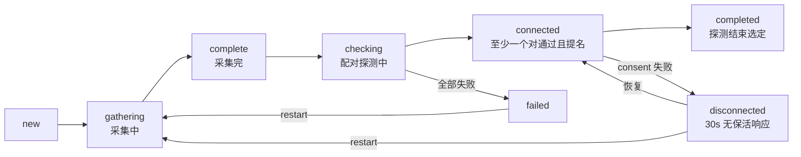

应用层能做的事：`oniceconnectionstatechange` 里对 disconnected 启动重连计时（你的 mediasoup 客户端的"10s 冷却自动 ICE 重启"就在这一层）、对 failed 直接 restart 或重建 PC。

<a id="ice-restart"></a>

## 4.5 ICE Restart

网络切换（WiFi↔有线）、NAT 重绑定后，旧候选对全部作废但不影响会话语义——**ICE Restart**：
1. 重新生成 ice-ufrag/ice-pwd（新凭据，老的立即失效——安全）；
2. 重新 gather（新网卡的新候选）；
3. 重新配对探测（老 RTCP 传输继续尝试维持）；
4. **不重新协商 SDP 编解码**（媒体参数不变），也不重跑 DTLS（密钥沿用）——比重建 PeerConnection 快得多，画面几乎无感（丢几帧）。
触发方式：`pc.restartIce()`（Chrome）或 createOffer({iceRestart:true})。mediasoup 协议里有专门的 `restartIce` protoo 请求，服务端生成新 ufrag/pwd 返回。

<a id="ice-nat"></a>

## 4.6 NAT 穿透能力矩阵

| 场景 | 结果 | 原因 |
|---|---|---|
| 同内网 host↔host | 直连 | 不经 NAT |
| Cone NAT ↔ Cone NAT | srflx 直连 | 双方映射稳定，互相打洞成功 |
| 对称 NAT ↔ Cone | **通常失败 → TURN** | 对称 NAT 给每个目的地址分配新端口，srflx 候选无效 |
| 企业防火墙（仅 443 TCP 出） | TCP 候选/TURN 443 | `--force-tcp`/TCP 候选；ICE 支持 UDP→TCP 降级 |
| 双侧对称 NAT | TURN 必选 | 打洞窗口无法预测 |
| WSL 场景 | host 候选即可通 | WSL2 vSwitch 对 Windows 主机可达（你的环境 172.18.x 直连） |

打洞时机本质：**双方同时向对方的 srflx 地址发包，让各自的 NAT 建立"对方地址 → 我的映射"表项**。谁先发包谁的映射先建立，所以 ICE 要求双方几乎同时探测。

---

<a id="dtls"></a>

# 5. DTLS 握手与 SRTP 密钥

## 5.1 与 ICE 的关系

ICE 选出 selected pair 后，**DTLS 握手就在这条 UDP 路径上进行**（复用同一 socket，包格式区分：STUN/DTLS/RTP 由首字节判别）。每个 ICE 传输一条 DTLS 会话（bundle 后所有 m-line 共享）。

## 5.2 握手与角色

- 角色由 SDP `a=setup` 决定：offer 方 `actpass`（我可任一），answer 方回 `active`（我做 DTLS client，发起 ClientHello）或 `passive`。mediasoup 协议里客户端在 connectWebRtcTransport 时上报 dtlsParameters（含 role），服务端取相反角色。
- **身份验证**：双方证书各产生一个指纹（SHA-256），随 SDP（a=fingerprint）交换；握手时核对证书哈希——**SDP 经信令可信通道送达，指纹即锚点**，中间人伪造证书指纹对不上 → 握手失败。
- 握手完成后用 TLS exporter 按 `SRTP profile`（如 `SRTP_AES128_CM_SHA1_80` / `AEAD_AES_256_GCM`）**导出对称密钥**，客户端密钥与服务端密钥分开——这就是 DTLS-SRTP 的密钥交换（SDES 方式已废弃）。


## 5.3 SRTP 细节

- RTP 头**明文**（序列号/时间戳/SSRC 可被中间设备读取），payload 与部分扩展加密；每包带 4 字节认证 tag（防篡改）。
- **防重放**：SRTP 用滑动窗口校验序列号——这也是**重传包必须走 RTX 流（不同 SSRC/序列号空间）**的原因之一。
- 密钥不轮换（会话级）；DTLS renegotiation 可换密钥但极少用。
- DataChannel 走同一条 DTLS 上的 SCTP（独立于 SRTP 的另一种封装）。

---

<a id="tx"></a>

# 6. 发送侧媒体管道与 Pacer

<a id="tx-pipeline"></a>

## 6.1 管道流水线

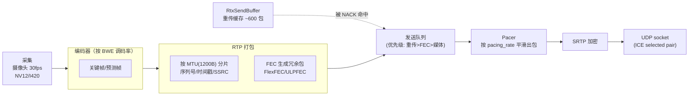

- **序列号从打包层开始**，一路贯穿到接收端 NACK——这是所有 ARQ/FEC/反馈的锚点。
- 重传缓存：每个已发包存进 RtxSendBuffer（约几百包，覆盖几秒），等 NACK 命中后从 RTX 流重发。

<a id="tx-rtp"></a>

## 6.2 RTP / RTCP 基础

- **RTP 头**：SSRC（流身份）、序列号（丢包检测）、时间戳（帧间时序，90kHz 视频）、payload type（codec 定位）、marker bit（帧最后一包）。
- **关键扩展**：
  - `transport-wide-cc`：**传输层序列号**（跨流统一计数），TWCC 反馈靠它；
  - `abs-send-time` / `abs-capture-time`：发送/采集时刻，延迟梯度估算用；
  - `video-orientation`：画面旋转。
- **RTCP**（对控制流做反馈，5% 带宽内）：SR（发送统计）/RR（接收统计：丢包率、jitter、RTT）、PLI/FIR（关键帧请求）、NACK、REMB、TWCC feedback、xr 报告。
- **SSRC 组**：`FID 1111 2222` 表示 2222 是 1111 的 RTX 重传流；simulcast 时每个层一个 SSRC。

<a id="tx-pacer"></a>

## 6.3 Pacer 平滑器

**为什么需要**：一帧编码完成会瞬间产出几十 KB（几十个 RTP 包）——比如 2Mbps@30fps 下每 33ms 一帧 ≈ 8KB，瞬时速率 ≈ 2Mbps×30 = 不限速地灌进 UDP 会造成：
1. 路由器队列瞬满 → 丢包（**自伤式丢包**，BWE 误判为网络差）；
2. 延迟梯度尖刺 → GCC 误判 overuse。

**Pacer 做法**：
- 维护 pacing_rate（由 BWE 决定，通常是估计带宽的 ~90%）与令牌预算：每 5ms 一轮（burst 窗口），按预算放行若干包；
- 包分优先级出队：**音频 > 重传(RTX) > FEC > 视频媒体**——重传和音频抢时限，视频让路；
- 目标延迟：把一帧的包摊开在 ~几十 ms 内发完（避免与帧间隔同数量级的突发）；
- **ALR（Application-Limited Region）**：当发送速率低于 pacing_rate（没数据可发，如画面静止），标记为"应用受限"——此时 BWE 不因"发不满"而下调（重要：静止画面不能把带宽估没）。

```
编码出帧：|--30KB--|          |----30KB----|
不经 pacer：▓▓▓▓▓▓▓▓▓▓ 瞬时洪峰
经 pacer：  ▂▃▄▅▆▇ 平滑铺开（5ms 窗口逐波放出）
```

**面试点**：没有 Pacer 会怎样？——突发丢包 + BWE 误判；Pacer 的速率谁定？——BWE 的估计值（乘安全系数）；音频为什么优先？——耳感延迟敏感，且音频码率小。

---

<a id="bwe"></a>

# 7. 带宽估计 BWE ★

BWE 回答：**"现在能发多快"**。这是 WebRTC 体验的核心——估高了丢包卡顿，估低了画质拉胯。

<a id="bwe-evo"></a>

## 7.1 演进：REMB → Transport-CC

| 方案 | 估计位置 | 反馈 | 问题 |
|---|---|---|---|
| **接收端估计（REMB 时代）** | 接收端（浏览器） | RTCP REMB 报文告发送端"我算出你能用 X Mbps" | 多流场景接收端难统筹；估计器离数据远 |
| **发送端估计（TWCC，现行）** | **发送端**（GCC 算法） | 接收端只上报"每个传输层序号几时到达"（transport-cc feedback） | 反馈包略大；但估计器能看到全链路、多路统一调度 |
| mediasoup/SFU | SFU 侧对每 subscriber 做 | 客户端发 TWCC feedback 给 SFU，SFU 算出下行带宽再控制转发/编码层选择 | SFU 场景标准形态 |

Chrome/SFU 现在默认 **transport-cc + 发送端 GCC**；REMB 报文还在兼容保留。

<a id="bwe-twcc"></a>

## 7.2 TWCC 反馈机制

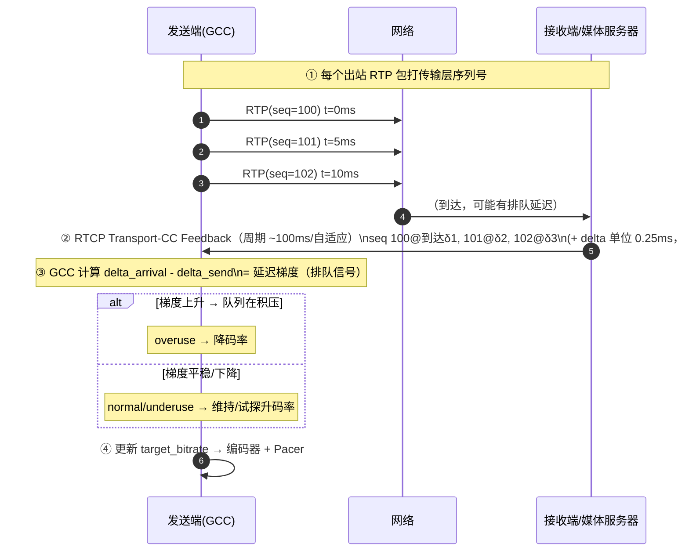

- 反馈报文里是**到达时刻序列**（相对于上一个反馈块的 0.25ms 增量），发送端配对自己的发送时刻与 abs-send-time 扩展 → 得到每包的端到端延迟。
- 反馈周期自适应（约每 100ms 或按包数），丢的包在位图里标记——**TWCC 同时是丢包信息源**（喂给丢包型估计）。

<a id="bwe-gcc"></a>

## 7.3 GCC 算法状态机

GCC（Google Congestion Control）= 三模块：

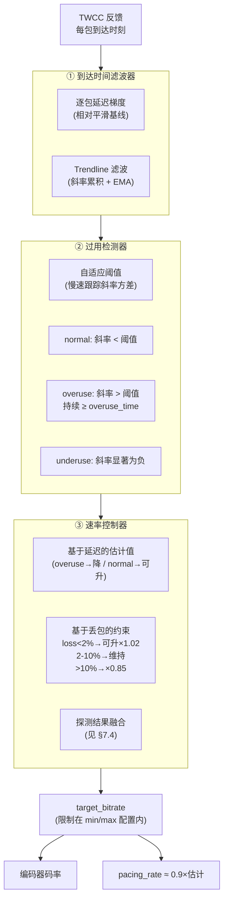

关键行为：
- **降快升慢**：overuse 时指数退避（×0.85 起）快速让路；normal 时加性增长试探。
- **阈值自适应**：固定阈值会把噪声当拥塞，GCC 让阈值跟随斜率波动自适应（`thr += K×(|slope|-thr)×dt`）。
- **降码率时的 floor**：最低码率由编码器最小值+优先级分配决定（视频会被压到很惨但音频不降）。
- **overuse 的确认需要持续几秒**（防瞬时抖动误杀）——探测到一次尖刺不会立刻降码率。

<a id="bwe-probe"></a>

## 7.4 带宽探测 Probe

**问题**：加性增长太慢（每轮 +几 kbps），新建会话/网络突然变好时，怎么快速摸到真实带宽上限？

**做法**：Pacer 在极短时间内**超速发一组探测包**（不排队、立即出）：
- 探测速率 = 当前估计 × 1.5（第一簇）、×2（第二簇），每簇持续约 15~30ms；
- 探测包与媒体包同流发出（TWCC 序号连续），GCC 事后**从反馈里识别探测簇**（按发送时间聚簇），用"簇内到达速率"计算探测出的带宽；
- 若探测簇到达间隔≈发送间隔（没排队）→ 该速率下网络通畅 → 提升估计；若到达间隔明显拉长 → 上限到了。
- 探测包标记为 non-elastic，**不计入正常 BWE 的正常流量统计**；ALR 状态下触发（应用没在发满时才探测，防止与业务流量冲突）。
- 触发时机：会话初始（起播探测）、估计长期未增长、屏幕共享开始（大码率需求）、从 overuse 恢复。

**面试点**：探测为什么用"簇"而不是持续超发？——短簇可以测出瓶颈带宽而几乎不造成持续拥塞。

<a id="bwe-alloc"></a>

## 7.5 码率分配与编码器联动

target_bitrate 产生后如何花：

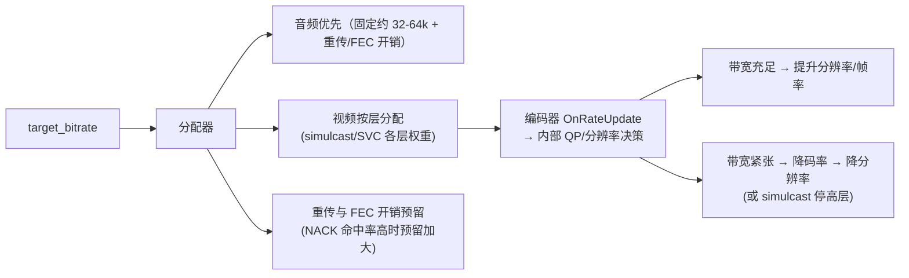

- 编码器拿到新码率不是瞬间生效——有率控平滑，且**降码率通常先降 QP/帧率，最后降分辨率**（分辨率变化会触发 keyframe，见 Simulcast 章）。
- 音视频分配比例、各 simulcast 层的 bitrate 权重，都可在 SDP/`setParameters` 里配（maxBitrate/scaleResolutionDownBy）。

---

<a id="simulcast"></a>

# 8. Simulcast 与 SVC ★

解决同一个矛盾：**发送端想要一套码流，接收端们网速各不相同**。SFU 不转码（转码太贵），所以要么发多套（simulcast），要么一套内部分层（SVC）。

## 8.1 Simulcast（同源多流）

**原理**：同一摄像头源，**N 个独立编码器**同时编码出 N 路（如 720p@2.5M、360p@500k、180p@150k），每路独立 SSRC/RTP 流。SDP 里用 `a=simulcast:send h;med;lo` + `a=rid` 声明。接收端（SFU）按每个订阅者的 BWE 决定转发哪一层——**纯包转发，零转码**。

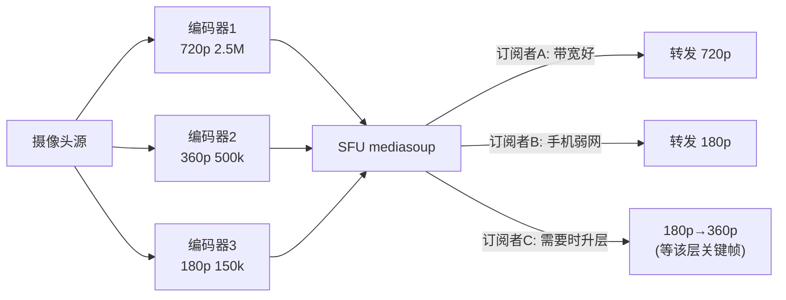

- **代价**：端上 CPU ×N（3 路 720p 编码很吃 CPU）、上行带宽 ×N（SFU 场景上行三路全发）。
- **切换层的时机约束**：只能在该层**关键帧**处切换（任意时刻切进 P 帧流解不出）→ 所以 simulcast 层会周期性发 key（keyframe interval），SFU 收到新订阅请求时等该层下一个 key 再转发（这就是"切换要等 1~2 秒"的原因）。
- mediasoup：`produce({ encodings: [{rid:'h',...},{rid:'m'...}] })` 建 N 个 Producer；消费侧 `consumer.setPreferredLayers({ spatialLayer, temporalLayer })`。
- 你的客户端里 SVC 与 simulcast 互斥（代码里 SVC 走 Produce encodings 的 scalabilityMode），正是这个约束的体现。

## 8.2 SVC（单流分层）

**原理**：**一个编码器一条 RTP 流**，内部把码流编成可分层解码的结构：
- **时间分层（temporal）**：T0 层=低帧率基础帧，T1/T2 层=中间补充帧；丢掉高层只是帧率降（参考结构用 TL0 组，高层不作为低层参考）；
- **空间分层（spatial）**：S0=低分辨率完整流，S1 在 S0 之上叠加高分辨率残差。

VP9/AV1 的 SVC 模式（`L1T3`/`L3T3_KEY` 等 scalabilityMode）+ `setPreferredLayers` 控制下发哪层。对比 simulcast：**上行只有一路**（省 CPU/上行），但解码端/链路上任何丢包影响跨层引用，且 SFU 需按层过滤 RTP 包（mediasoup 支持）。

| 维度 | Simulcast | SVC |
|---|---|---|
| 上行开销 | N 路全发 | 1 路（含层） |
| 端上 CPU | N 个编码器 | 1 个（分层略增） |
| 抗丢包 | 层间独立，切换干净 | 层间引用耦合，丢包影响更大 |
| 层切换延迟 | 等目标层 keyframe | 立即（丢高层即降） |
| 兼容性 | 广泛 | 需 VP9/AV1 |

## 8.3 订阅选择与自动降级

SFU 侧逻辑（mediasoup 典型）：
1. 订阅者 TWCC 反馈 → SFU 内 GCC → 该订阅者可用带宽；
2. `preferredLayers` + 可用带宽 → 选 spatialLayer/temporalLayer；
3. 带宽掉 → 降 temporalLayer（帧率减半，立即）→ 再不够降 spatialLayer（分辨率降，等下一 frame）；
4. `activeSpeaker`/布局变化也会触发切层（放大显示的人给高层）。

---

<a id="nack"></a>

# 9. 丢包恢复：NACK/RTX 与 FEC

两类武器：**ARQ（重传）**——丢了就补发；**FEC（前向纠错）**——先发冗余，丢了靠冗余恢复。WebRTC 两者并用，按网络状态动态配比。

<a id="nack-rtx"></a>

## 9.1 NACK 与 RTX 重传流

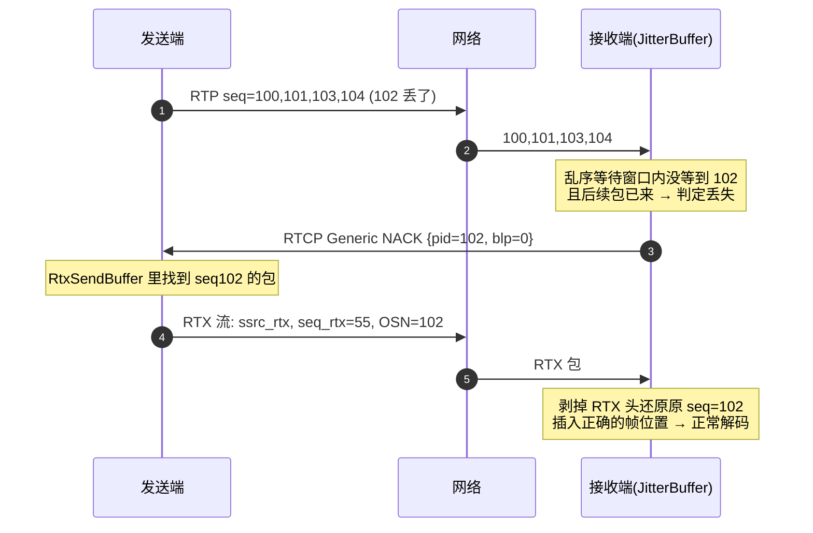

- **触发判定**：接收端按序列号排序，`等待窗口（乱序容忍，约几十 ms）` 过后仍缺 seq 且后续 seq 已到 → NACK。
- **RTX 流（RFC 4588）**：重传包不回原序列号空间（原流序列号要严格递增），用**独立 SSRC+独立序列号**，包内 OSN 字段（original sequence number）标注对应哪个原包。好处：接收端统计干净、防重放窗口互不干扰。
- **NACK 风暴控制**：发送端合并 NACK（同一包多次请求有间隔递增，200ms 起步翻倍）；接收端对同一包最多重发 N 次。
- **RTX 缓存**：发送端 RtxSendBuffer 存最近的包（几百包量级），太久的丢包 NACK 不回来 → 走 PLI（关键帧重发）兜底。

<a id="fec"></a>

## 9.2 FEC 前向纠错

| 技术 | 用途 | 原理 |
|---|---|---|
| **FlexFEC**（视频，现代） | 保护视频 RTP 包 | XOR 矩阵掩码：一组媒体包异或生成冗余包，丢任意 ≤1 个可恢复（按掩码组合可恢复更多） |
| **ULPFEC**（视频，旧） | 同上（兼容） | 非均匀保护：前段包强保护、后段弱 |
| **RED**（RFC 2198） | 音频小包冗余 | 一包里捎带上一个包的副本 |
| **Opus inband FEC**（音频） | 常开 | 编码当前帧时低码率捎带上一帧的粗版本，丢包后解码器拼合 |

- **FEC 率联动**：丢包率高 → 提高 FEC 冗余（但挤占有效码率）→ 极端时宁可降码率保 FEC。视频 FEC 由 BWE/丢包联合驱动；Opus FEC 默认开（小开销）。
- FlexFEC 只保护媒体包且与 RTX 流共存；帧完整性恢复优先用 NACK（成本低），FEC 兜底（RTT 大/丢包突发的场景收益高）。

<a id="nack-vs-fec"></a>

## 9.3 NACK vs FEC 分工

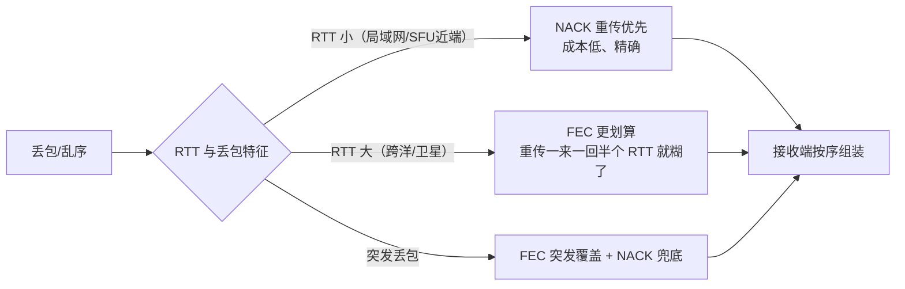

- **RTT 阈值直觉**：RTT < ~100ms NACK 收益高；跨洲 RTT 300ms+ 时重传延迟比 FEC 恢复慢得多。
- 你的 mediasoup 客户端在 WSL 中继下"2-3 帧每秒"的历史问题，就是典型的高丢包环境：FEC 开启 + NACK 命中不足 → 只能靠降码率。

---

<a id="rx"></a>

# 10. 接收侧：JitterBuffer 与 NetEQ

网络给的包是**乱序、抖动、偶丢**的；渲染需要的是**平稳时序、完整**的。接收侧的使命就是这场"整形"。

<a id="rx-video"></a>

## 10.1 视频：帧完整性等待与解码队列

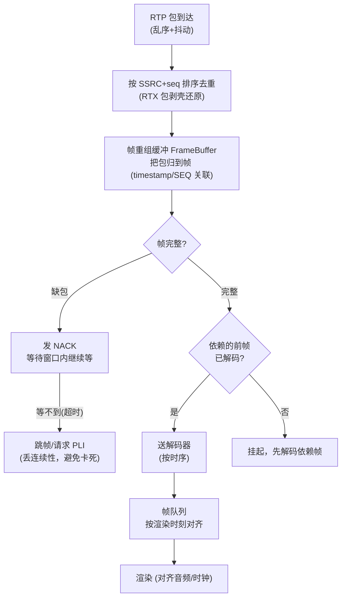

要点：
- **等待策略是延迟的第一来源**：丢包后宁可多等几十 ms 攒 NACK/FEC 恢复，也不立即跳帧（跳了就要等 keyframe 才能恢复完整画面）。
- **关键帧请求**：连续性破坏（丢帧、新订阅、分辨率切换）→ 接收端发 **PLI**（Picture Loss Indication）或 FIR → 发送端编码器强制出 keyframe（`OnReceivedIntraFrameRequest`，你的 MF 编码器里就是 CODECAPI_AVEncVideoForceKeyFrame）。
- **解码顺序 = 显示顺序**需要额外管理（B/P 帧依赖前帧，帧队列按 capture timestamp 排）。

<a id="rx-jitter"></a>

## 10.2 抖动估计

- RTP 层的 `jitter`（RTCP RR 里的）= 相邻包到达间隔与发送间隔之差的 EMA——原始信号。
- WebRTC 实际用**卡尔曼滤波**（VideoJitterDelayEstimator）在"到达时间 - 发送时间"的偏差上估计网络抖动分量，结果决定视频帧的**目标等待时长**：
  - 抖动大 → 多等（缓冲深，延迟高但连续）；
  - 抖动小 → 少等（延迟低）。
- 音频 NetEQ 同理但粒度是 10ms 帧，控制更精细。

<a id="rx-neteq"></a>

## 10.3 音频 NetEQ（抖动缓冲 + 丢包隐藏）

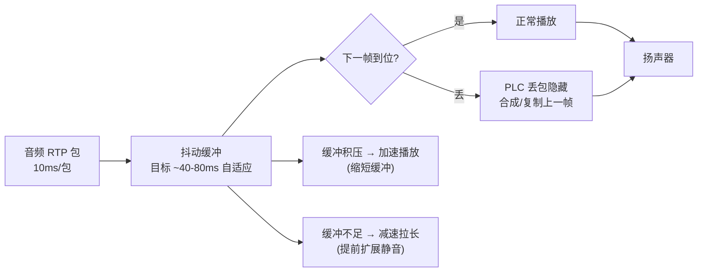

- **自适应**是 NetEQ 的灵魂：目标缓冲深度随实测抖动伸缩；缓冲过深（延迟高）用"加速"（时间压缩算法）追回；缓冲将枯用"减速"（拉长）续命。
- **PLC（Packet Loss Concealment）**：丢包时不静音而是"编"一段过渡音频（Opus 自带 PLC），听感连续。
- 音频延迟目标远小于视频（耳感对延迟极敏感），所以弱网下常见"音先画后"。

<a id="rx-latency"></a>

## 10.4 端到端延迟分解


优化抓手对应章节：编码延迟（硬编/低延迟模式）、Pacer（§6.3）、网络（ICE 路径选择 §4）、JitterBuffer（§10.1 等待策略）、解码（硬解）。**弱网时 JitterBuffer 与重传等待往往占大头**。

---

<a id="rtcp"></a>

# 11. RTCP 报文全家福

| 报文 | 类型 | 方向 | 作用 | 关联章节 |
|---|---|---|---|---|
| **SR** Sender Report | 200 | 发→收 | 发送统计：NTP/RTP 时间戳、已发包数字节 | 时钟对齐、RTT |
| **RR** Receiver Report | 201 | 收→发 | 接收统计：累计丢包率、jitter、last seq | 丢包型 BWE |
| **SDES** | 202 | 双向 | CNAME 等身份（音视频联动分析用） | — |
| **BYE** | 203 | 双向 | 流结束 | — |
| **RTPFB NACK** | 205/1 | 收→发 | 丢包重传请求（pid+blp 位图） | §9.1 |
| **RTPFB TWCC** | 205/15 | 收→发 | 每包到达时刻（BWE 输入） | §7.2 |
| **PSFB PLI** | 206/1 | 收→发 | 画面丢失，请求关键帧 | §10.1 |
| **PSFB FIR** | 206/4 | 收→发 | 同 PLI（强请求，SFU 场景用） | §10.1 |
| **PSFB AFB(REMB)** | 206/15 | 收→发 | 旧接收端带宽估计 | §7.1 |
| **XR**（RTCP-XR） | 207 | 收→发 | 详细统计（如 discard、delay） | 细粒度诊断 |

频率：SR/RR 通常 ~1s 周期（带 5% 带宽上限）；NACK/TWCC 按需触发（TWCC ~100ms）。

---

<a id="stats"></a>

# 12. getStats 调试速查

浏览器 `pc.getStats()` / libwebrtc 证书级诊断（`chrome://webrtc-internals`）。排查时按链路顺序看：

| 阶段 | 指标（方向） | 意义 |
|---|---|---|
| ICE | `iceConnectionState`, `currentRoundTripTime` | 连通状态与 RTT |
| 传输 | `bytesSent/Received`, `availableOutgoingBitrate`(BWE 输出) | 吞吐与估计 |
| 发送-编码 | `framesEncoded`, `encoderImplementation`, `qpSum`, `targetBitrate` | 编码器是否吃满码率 |
| 发送-重传 | `nackCount`, `retransmittedPacketsSent`, `fecPacketsSent` | 丢包恢复压力 |
| 接收-恢复 | `packetsLost`, `nackCount`(收), `pliCount`, `fecPacketsReceived`, `jitter` | 网络质量 |
| 接收-缓冲 | `jitterBufferDelay`, `jitterBufferEmittedCount` | 缓冲等待（延迟大头） |
| 接收-解码 | `framesDecoded`, `framesDropped`, `decoderImplementation`, `freezeCount` | 解码与渲染健康 |
| 音频 | `audioLevel`, `concealedSamples`, `totalPlayoutDelay` | NetEQ 隐藏量（丢包听感） |

**典型症状对照**：
- `packetsLost↑ + nackCount↑`：网络丢包 → 看 FEC/码率/ICE 路径；
- `jitterBufferDelay` 巨大：抖动大或丢包等待 → 弱网；
- `freezeCount↑ + framesDropped↑`：解码跟不上或关键帧风暴（频繁 PLI）；
- `targetBitrate` 一直低：BWE 被压 → TWCC 反馈/网络瓶颈/SFU 转发受限；
- `qpSum/framesEncoded` 波形：编码器在码率与分辨率间挣扎。

---

## 结语：一张图串起所有机制

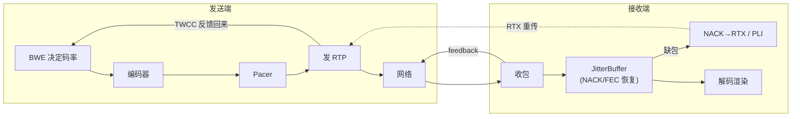

- **建连**（§3-5）解决"能不能通"；
- **BWE/Pacer**（§6-7）解决"发多快"；
- **Simulcast/SVC**（§8）解决"发给谁发哪层"；
- **NACK/FEC**（§9）解决"丢了怎么办"；
- **JitterBuffer/NetEQ**（§10）解决"乱序抖动怎么按时播"。
五条线交织成一个实时音视频系统，任何一条出问题都会体现在 getStats 的对应指标上——这就是排障的地图。

